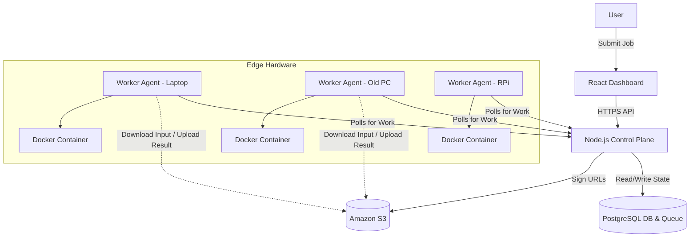
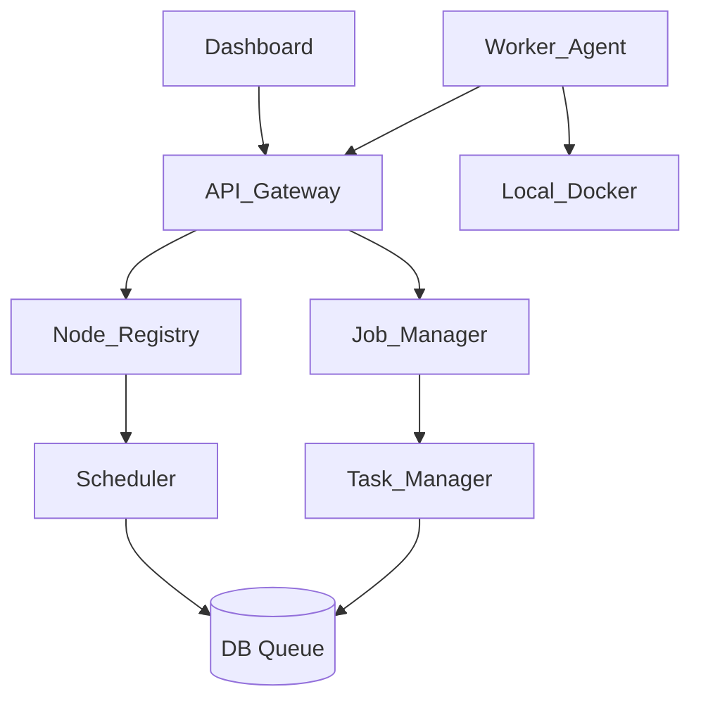
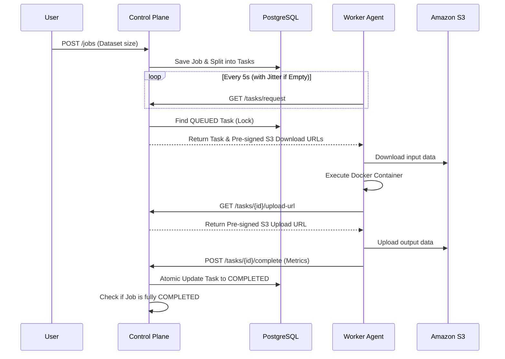
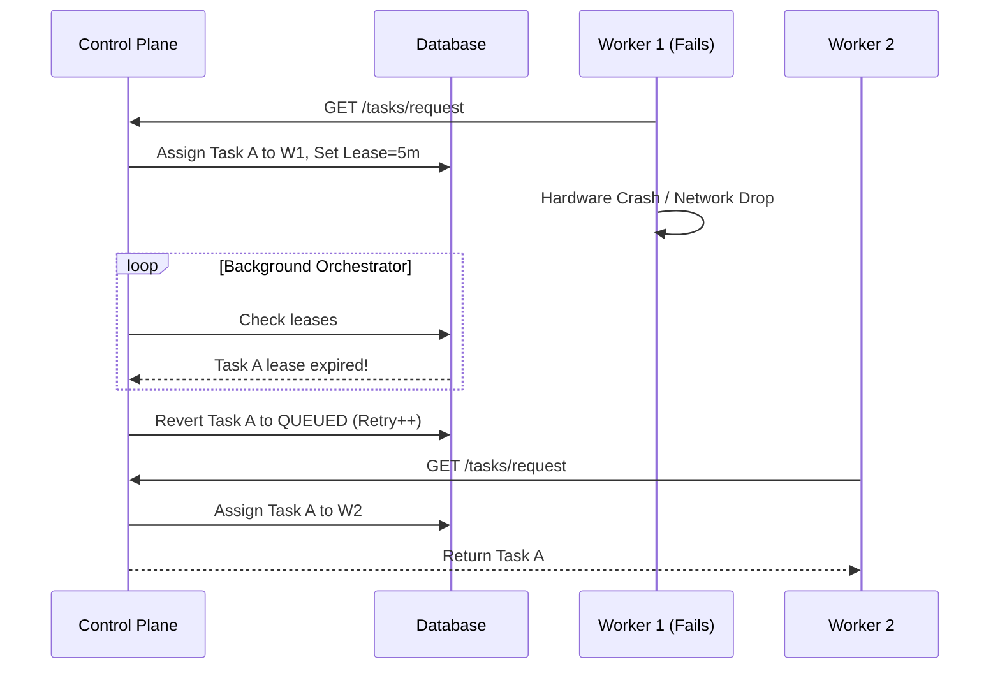

# E-Waste Compute Grid — Architecture Design Document

This document serves as the foundational architecture specification for the E-Waste Compute Grid, mapping directly to the team execution constraints and phases. It has been fortified to handle distributed systems edge cases such as network partitions, race conditions, and thundering herds.

## 1. System Overview
The E-Waste Compute Grid is a distributed computing platform designed to give retired or underutilized computers a second life. It operates by enrolling these machines as voluntary worker nodes. A central Node.js control plane registers workers, breaks parallelizable jobs (e.g., batch image inference) into independent tasks, and assigns them to compatible workers. The system monitors worker health via heartbeats, handles hardware failures by requeuing abandoned tasks, aggregates results, and displays real-time operational and energy metrics on a React dashboard.

## 2. Component Architecture
* **React Dashboard:** The user-facing web interface.
* **Node.js Control Plane:** The central API backend coordinating the entire system.
* **Node Registry:** Sub-module tracking worker registration, heartbeats, and hardware capabilities.
* **Job Manager:** Sub-module handling job parsing and task generation.
* **Scheduler:** Sub-module evaluating worker capability and assigning tasks.
* **Task Manager:** Sub-module managing task state transitions and leases.
* **Queue:** Task holding area (implemented via PostgreSQL for the MVP).
* **Database:** Persistent storage for nodes, jobs, tasks, and metrics.
* **Worker Agent:** Lightweight Python daemon running on volunteer hardware.
* **Docker Runtime:** The isolated execution environment managed by the Worker Agent.
* **AI Workload:** The containerized batch processing application (e.g., ONNX/PyTorch).
* **Object Storage:** AWS S3 (or similar) for storing input datasets and output results.

## 3. Responsibility of Each Component
* **React Dashboard:** Submits jobs, visualizes live worker states (ONLINE/WORKING/OFFLINE), tracks job progress, and displays energy/performance metrics.
* **Node.js Control Plane:** Exposes REST APIs to the frontend and workers, enforces security, and runs background orchestrator loops.
* **Node Registry:** Maintains the source of truth for available compute resources and detects offline workers via missed heartbeats.
* **Job Manager:** Converts a large user job (e.g., 10,000 images) into smaller, idempotent tasks (e.g., 4 chunks of 2,500 images).
* **Scheduler:** Matches available tasks in the queue with capable, idle workers requesting work.
* **Task Manager:** Monitors task leases, triggers retries on timeouts, and processes successful result submissions.
* **Queue:** Provides a concurrency-safe mechanism for workers to pull tasks without duplication.
* **Database:** Stores relational state, acting as the ultimate source of truth to survive control plane restarts.
* **Worker Agent:** Authenticates the machine, detects local CPU/RAM/OS, polls for tasks, downloads input, triggers Docker, uploads output, and measures execution time.
* **Docker Runtime:** Ensures the AI workload runs consistently regardless of the host OS, preventing dependency conflicts on heterogeneous old hardware.
* **AI Workload:** Executes the actual inference script, reading from an input directory and writing to an output directory.
* **Object Storage:** Offloads heavy data transfer from the Node.js API, providing scalable storage for datasets.

## 4. Complete End-to-End Data Flow
1. **Enrollment:** Admin installs Worker Agent on an old PC. Agent posts hardware specs to Control Plane and receives an API token.
2. **Job Submission:** User uploads a dataset to S3, submits a Job payload to the Control Plane API via Dashboard.
3. **Task Generation:** Job Manager splits the Job into Tasks and writes them to the Database (status: `QUEUED`).
4. **Polling:** Worker Agent (status: `IDLE`) polls `GET /tasks/request`.
5. **Assignment:** Scheduler locks a compatible task, assigns it to the worker, updates task status to `ASSIGNED`, and returns task metadata (with S3 pre-signed **download** URLs only).
6. **Execution:** Worker Agent downloads input from S3, spins up the Docker AI Workload, and waits for completion.
7. **Submission:** Worker Agent requests an S3 upload URL, uploads results, and posts execution time/energy metrics to `POST /tasks/{id}/complete`.
8. **Aggregation:** Task Manager updates task status to `COMPLETED`. If all tasks for the job are done, Job Manager aggregates results and marks Job `COMPLETED`.
9. **Visualization:** Dashboard polls/receives websocket events and updates UI metrics.

## 5. Job Lifecycle
* `PENDING`: Job is created, Job Manager is currently chunking it into tasks.
* `QUEUED`: Tasks are generated and waiting in the queue.
* `IN_PROGRESS`: At least one task has been assigned to a worker.
* `COMPLETED`: All tasks have successfully finished and results are aggregated.
* `PARTIAL_SUCCESS`: Job finished, but some "poison pill" tasks hit max retries and failed. Valid results are still aggregated.
* `FAILED`: Job aborted critically (e.g., system failure).

## 6. Task Lifecycle / State Machine
* `QUEUED`: Ready to be processed.
* `ASSIGNED`: Leased to a worker for a specific duration.
* `COMPLETED`: Worker successfully submitted results.
* `FAILED`: Worker explicitly reported an unrecoverable error, or hit max retries.
* `TIMEOUT`: Worker failed to report back before lease expiration (Internal state transition -> reverts to `QUEUED` if retries remain).

## 7. Worker Lifecycle / State Machine
* `STARTING`: Agent booting up, running hardware detection/benchmarking.
* `ONLINE`: Registered successfully, ready to communicate.
* `IDLE`: Heartbeating, polling for tasks, currently unoccupied.
* `WORKING`: Currently executing a task container.
* `OFFLINE`: Control plane has not received a heartbeat within the threshold (e.g., 60 seconds).

## 8. Scheduler Design
For the MVP, the Scheduler follows a **Pull-Based** model with **Capability Filtering**:
* Workers actively poll the server when `IDLE`.
* On receiving a request, the Scheduler queries the queue for `QUEUED` tasks.
* It filters out tasks the requesting worker cannot handle (e.g., task requires 8GB RAM, worker has 4GB).
* The Scheduler selects the oldest compatible task (FIFO).
* Concurrency is managed at the database level using atomic locks (e.g., PostgreSQL `SELECT FOR UPDATE SKIP LOCKED`).

## 9. Worker Selection / Scoring Logic
While a pure pull-based model handles assignment on a first-come, first-served basis, scoring determines priority if multiple tasks are available, or if the server batches requests:
`Score = (CPU_Cores * Clock_Speed) * (RAM_GB) * capability_flag - estimated_energy_cost`
*MVP Implementation:* The worker Agent sends its baseline capabilities. The Scheduler only assigns a task if the worker passes a boolean capability check (e.g., `worker.ram >= task.min_ram`). If true, the worker gets the task. 

## 10. Queue Design
* **Technology:** PostgreSQL (Database as a Queue).
* **Why:** Avoids the overhead of deploying and managing a separate Redis or SQS cluster during the hackathon. 
* **Mechanism:** Tasks table acts as the queue. `SELECT * FROM tasks WHERE status = 'QUEUED' LIMIT 1 FOR UPDATE SKIP LOCKED;` ensures multiple workers polling simultaneously do not receive the same task.
* **Edge Case Mitigation:** The assignment transaction is committed *immediately* after marking the task as `ASSIGNED` to prevent long-running transactions and connection pool starvation.

## 11. Database Entities and Relationships
* **Node:** `id`, `name`, `status`, `cpu_cores`, `ram_gb`, `capabilities` (JSON), `performance_score`, `last_heartbeat`.
* **Job:** `id`, `name`, `status`, `total_tasks`, `completed_tasks`, `created_at`, `completed_at`.
* **Task:** `id`, `job_id` (FK), `node_id` (FK, nullable), `status`, `payload` (JSON), `result` (JSON), `retry_count`, `lease_expires_at`.
* **Metric:** `id`, `node_id` (FK), `job_id` (FK), `execution_time_ms`, `energy_wh`, `timestamp`.

## 12. API Architecture
RESTful JSON API over HTTPS:
* `POST /api/nodes/register` - Worker initial enrollment.
* `POST /api/nodes/{id}/heartbeat` - 30s interval liveness ping.
* `GET /api/tasks/request` - Worker asks for work.
* `GET /api/tasks/{id}/upload-url` - Worker requests fresh S3 upload URL post-execution.
* `POST /api/tasks/{id}/complete` - Worker submits success and metrics.
* `POST /api/tasks/{id}/fail` - Worker submits error.
* `POST /api/jobs` - Dashboard submits new job.
* `GET /api/dashboard/sync` - Dashboard fetches aggregated state.

## 13. Worker ↔ Server Communication Protocol
* **Protocol:** HTTP/HTTPS polling.
* **Flow:** 
  * Background thread in Python Agent runs an infinite loop.
  * Sends heartbeat every 30s.
  * If state is `IDLE`, sends task request.
  * Server responds with `200 OK` (with JSON task payload) or `204 No Content` (no work available).
* **Edge Case Mitigation (Thundering Herd):** If the server responds with `204 No Content` (queue is empty), the Worker Agent implements **Exponential Backoff with Jitter** (e.g., waits 5s, then 10s, then 20s, up to 60s, plus or minus a random 2 seconds). This prevents hundreds of workers from simultaneously hammering the DB when a new job is created.

## 14. Heartbeat Mechanism
* **Worker side:** Agent sends a minimal JSON payload `{ "nodeId": "...", "state": "IDLE/WORKING", "activeTaskId": "..." }` every 30 seconds.
* **Server side:** Node Registry updates the `last_heartbeat` timestamp in the DB. A background cron job runs every 60 seconds. Any node where `now() - last_heartbeat > 60s` is marked `OFFLINE`.

## 15. Task Lease / Timeout Mechanism
* **Initial Assignment:** When a task is assigned, `lease_expires_at` is initially set to `now() + 5_minutes`.
* **Lease Extension:** To mitigate slow network/hardware issues, if a worker is actively executing a task, its 30s `/heartbeat` ping will automatically push the `lease_expires_at` forward.
* **Timeout Execution:** The server's background loop looks for tasks where `status = 'ASSIGNED'` and `now() > lease_expires_at`. These tasks are transitioned to `TIMEOUT` and subsequently requeued.

## 16. Retry and Fault-Tolerance Design
* **Idempotency:** AI inference tasks are pure functions (Input -> Output) without side effects, making them safe to retry.
* **Max Retries:** Task table includes `retry_count`. Max = 3.
* **Zombie Worker Protection:** If a worker drops offline, its task times out and is reassigned. If the original worker suddenly reconnects and tries to call `/complete`, the API will verify `task.node_id == requesting_node_id`. If they don't match, the late submission is rejected.
* **S3 Collisions:** Output S3 paths include the `task.retry_count` (e.g., `/job-1/task-2/retry-0/result.json`) so two workers accidentally processing the same task at the exact same time don't overwrite each other's data files.
* **Poison Pills:** If a task explicitly hits max retries (e.g., a corrupted image crashes the container every time), it becomes `FAILED`, but the rest of the Job is allowed to continue to `PARTIAL_SUCCESS`.

## 17. Result Aggregation Design
* Workers upload heavy output files to S3, and post the S3 URLs in the `/complete` API payload.
* The Control Plane saves these URLs in the Task row.
* **Edge Case Mitigation (Race Conditions):** When a task finishes, the DB uses an atomic update: `UPDATE jobs SET completed_tasks = completed_tasks + 1 WHERE id = X RETURNING completed_tasks`. Only the exact request that receives `completed_tasks == total_tasks` triggers the final Job aggregation, ensuring multiple tasks finishing at the exact same millisecond don't cause duplicate aggregation runs.

## 18. Authentication / Enrollment Design
* **Method:** Pre-shared Token Enrollment.
* For the hackathon, an admin generates a static `ENROLLMENT_TOKEN`.
* The Worker Agent is started via CLI: `python agent.py --enrollment-token XYZ`.
* The Agent calls `/register` with the token. The server verifies the token and responds with a unique, permanent `node_id` and a scoped `node_secret` saved locally on the worker for future API calls.

## 19. Security Boundaries
* **Isolated Execution:** The AI workload runs strictly inside Docker. The Worker Agent itself does not execute arbitrary code strings from the server.
* **Dynamic S3 Credentials:** Pre-signed URLs for *uploading* results are NOT provided at task assignment. AWS pre-signed URLs expire. If a worker takes longer than the expiration time, the upload fails. Instead, the worker requests a fresh upload URL dynamically via `GET /api/tasks/{id}/upload-url` right before uploading.

## 20. Docker Execution Model
* The Control Plane defines the workload as a published Docker image tag (e.g., `ewaste/image-inference:v1`).
* The Worker Agent receives the image tag in the task payload.
* Agent executes: `docker run --rm -v /local/tmp/input:/data/input -v /local/tmp/output:/data/output <image_tag>`.
* By mounting volumes, the Python agent handles network I/O, while the container only performs local file I/O compute, keeping network credentials out of the container.

## 21. Energy / Metrics Architecture
* **Baseline Measurement:** Instead of hardware power meters for all nodes, use a lookup table based on hardware detection (e.g., RPi = 5W, Old Laptop = 45W, Desktop = 150W).
* **Calculation:** `Energy (Wh) = Baseline Power (W) * (Execution_Time_Seconds / 3600)`.
* **Reporting:** The Worker Agent calculates execution time from container start to container exit, runs the formula, and includes `executionTimeMs` and `energyWh` in the task completion payload.

## 22. Real-Time Dashboard Event Architecture
* **Phase 1-6 (MVP):** Short polling. React app calls `GET /api/dashboard/sync` every 3 seconds to fetch aggregated counts (nodes online, jobs running, tasks complete) to ensure reliable demonstration.
* **Phase 8 (Polish):** Replace polling with WebSockets (`socket.io`). The Node.js server emits events (`NODE_STATUS_CHANGE`, `TASK_COMPLETED`) to connected clients for a true real-time feel.

## 23. AWS Deployment Architecture
* **Frontend:** Deployed to AWS Amplify or S3 + CloudFront.
* **Control Plane API:** AWS App Runner or ECS Fargate (Dockerized Node.js).
* **Database:** Amazon RDS (PostgreSQL).
* **Storage:** Amazon S3 (Buckets for /inputs and /outputs).
* **Workers:** Run locally on physical team hardware, communicating outbound to AWS via HTTPS.

## 24. Repository / Monorepo Structure
```text
/e-waste-compute-grid
  /frontend        (React, Vite, TailwindCSS)
  /control-plane   (Node.js, Express, Prisma/Sequelize)
  /worker          (Python agent, psutil, docker-py, requests)
  /workloads       (Dockerfiles, Python AI inference scripts)
  /infra           (AWS deployment scripts / docker-compose for local)
  /docs            (API contracts, schema definitions)
```

## 25. Local Development Architecture
* A single `docker-compose.yml` in `/infra` to spin up:
  1. PostgreSQL database
  2. Node.js backend (hot-reloading)
  3. Two simulated Python Worker Agents
* Frontend runs locally via `npm run dev` pointing to `localhost:3000`.

## 26. Hackathon MVP vs Future Production Architecture
* **MVP:** PostgreSQL for queuing (SKIP LOCKED), API short-polling, estimated static energy metrics, pre-trusted team nodes.
* **Production:** Amazon SQS/Kafka for high-throughput queuing, WebSocket event bus, hardware-level power metering (e.g., RAPL API), strict multi-tenant sandboxing (Firecracker microVMs), and a fully automated public enrollment flow.

## 27. Technology Decisions with Justification
* **Node.js + Express (Control Plane):** 
  * *Why:* Extremely fast to iterate, excellent at handling thousands of async I/O polling connections from workers. 
  * *Alternative:* Python/Django. 
  * *Hackathon Choice:* Node.js is chosen for ease of sharing DTO types with the React frontend and fast API setup.
* **PostgreSQL (Database & Queue):** 
  * *Why:* Simplifies infrastructure. A relational database handles the relational state (Jobs -> Tasks) perfectly, and `SKIP LOCKED` makes it a safe queue. 
  * *Alternative:* MongoDB + Redis. 
  * *Hackathon Choice:* PostgreSQL prevents the team from managing multiple stateful services.
* **Python (Worker Agent):** 
  * *Why:* Python has standard libraries for deep hardware inspection (`psutil`) and AI integrations, making it the perfect glue language for the edge agent. 
  * *Alternative:* Golang. 
  * *Hackathon Choice:* Python is more accessible for student teams and AI integrations.
* **Docker (Execution):** 
  * *Why:* Solves "it works on my machine" for old heterogeneous hardware with varying OS and dependency states. 
  * *Alternative:* Native Python virtual environments. 
  * *Hackathon Choice:* Docker guarantees the demo workload will actually run without library conflicts on demo day.

---

## Appendix

### A. Final Architecture Diagram


### B. Component Dependency Diagram


### C. Job/Task Sequence Diagram


### D. Worker Failure Sequence Diagram


### E. Recommended Repository Structure
See Section 24 for the outlined monorepo structure utilizing `frontend`, `control-plane`, `worker`, `workloads`, and `infra` directories.

### F. Architectural Decisions to Freeze Before Coding
1. **API Contracts:** Exact JSON schemas for Node Registration, Heartbeat, Task Request, and Task Result.
2. **State Machines:** Freeze the exact string values for Node and Task statuses to prevent frontend/backend mismatches.
3. **Queue Tech:** Commit to PostgreSQL `SKIP LOCKED` to avoid wasting time configuring Redis.
4. **Energy Formula:** Agree on the baseline static wattage assumptions for hardware types before building the backend metric schema.

### G. Questions/Ambiguities the Team Must Resolve
1. **AI Workload:** Specifically what model will Nikhil use? (e.g., MobileNet vs YOLO) — This defines the Docker image size.
2. **Network Model:** Are all demo computers on the same physical WiFi, or are we routing over the public internet to AWS from day 1?
3. **Result Payload:** Will the image inference output be a text summary (JSON) or actual processed image files? (Affects S3 integration necessity).
4. **Hardware Verification:** Do we have access to a physical power meter to validate at least one machine's energy footprint for the judge presentation?
