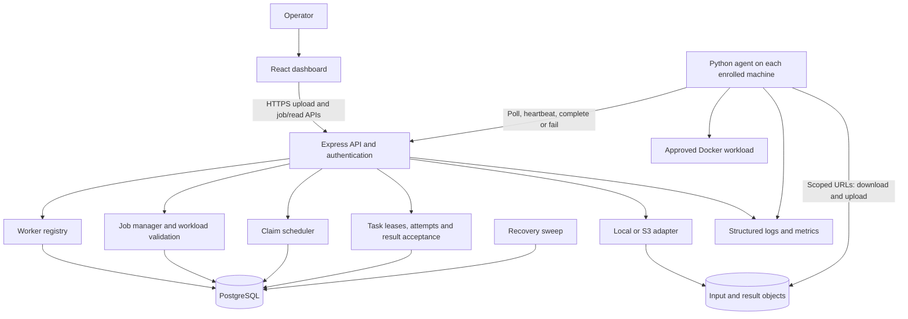
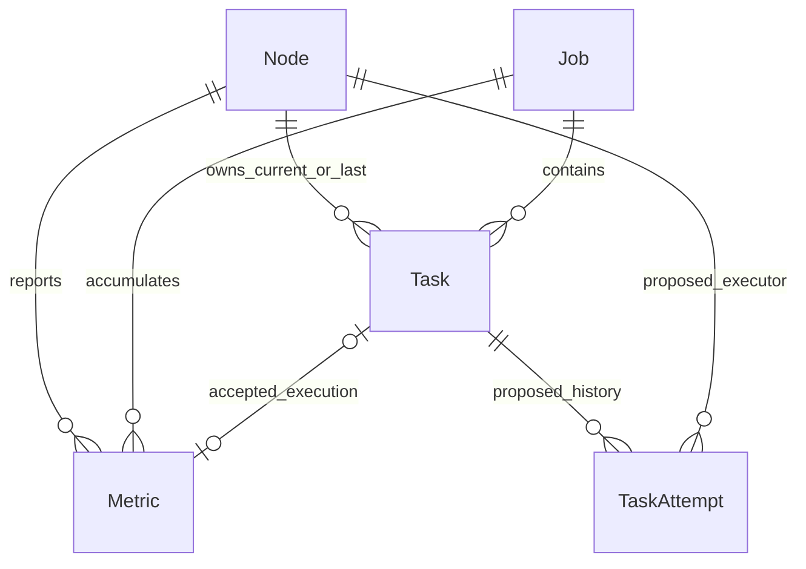
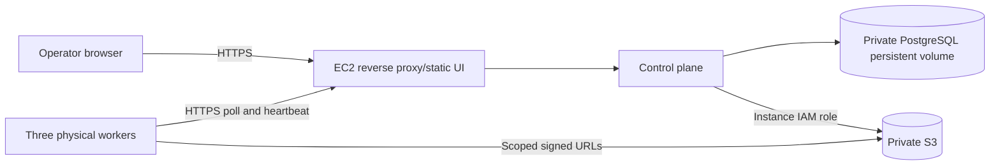

# E-Waste Compute Grid: master project plan

**Owner:** Kushagra, with Harry as architecture/mentoring support and Sejal as implementation support.  
**Planning baseline:** repository inspected on 7 October 2026; runtime evidence from the earlier audit in this same conversation.  
**Scope of this deliverable:** documentation and design only. Proposed modules, fields, endpoints, and phases below are not implemented by this document.

## How to use this document

Read parts 1–3 to understand the system. Use part 4 to choose an implementation phase and part 20 to choose its priority. Parts 6–15 are engineering contracts and acceptance guidance. Use part 19 as the release checklist. After each Sejal task, update the evidence ledger, issues, and current phase here with the command, environment, result, and remaining limitations. Do not mark a phase complete from code presence alone.

### Contents

1. [Current project and evidence](#1-current-project-and-evidence)
2. [Final product scope](#2-final-product-scope)
3. [System architecture](#3-system-architecture)
4. [Implementation roadmap](#4-implementation-roadmap)
5. [Vertical slices](#5-end-to-end-vertical-slices)
6. [Database design](#6-database-design)
7. [API design](#7-api-design)
8. [Worker design](#8-worker-design)
9. [Scheduler design](#9-scheduler-design)
10. [Failure handling](#10-failure-handling)
11. [Security](#11-security)
12. [Testing](#12-testing-strategy)
13. [Observability](#13-observability)
14. [Deployment](#14-aws-and-deployment)
15. [Dashboard](#15-frontend-and-dashboard)
16. [Live demonstration](#16-hackathon-demonstration)
17. [Portfolio quality](#17-portfolio-quality)
18. [Documentation inventory](#18-documentation-to-maintain)
19. [Definition of Done](#19-final-definition-of-done)
20. [Priority roadmap and next task](#20-priority-roadmap-and-immediate-next-task)

## 1. Current project and evidence

### Problem, solution, and boundaries

Functional retired/underused computers may still deliver useful computation. The system enrolls authorized machines, sends them independent pieces of supported jobs, tolerates failures, and reports the work and energy associated with that reuse. It cannot enroll inaccessible landfill hardware, combine distributed RAM into one machine, or establish that old hardware is inherently more efficient than modern infrastructure.

A **job** is the user's whole request. A **task** is a small independent portion. A **worker** executes a task. The **control plane** coordinates the system; it does not run the AI on behalf of the edge workers. A **lease** is temporary permission for one worker attempt to own a task. **Idempotency** means repeating an operation does not create an extra job or count a result twice.

Today the real workload is MobileNetV2 CPU image classification: image → class ID/name and confidence. `dummy` generates deterministic mock predictions for orchestration tests. A general-purpose workload platform is a future extension, not current behavior.

### What was inspected and what was run

The review covered the authored backend, Prisma schema, frontend/API client/styles, Python agent/executor, workload scripts, benchmark/scorer/energy utilities, tests, Dockerfiles, Compose, CI, environment examples, sample data, and project documentation. Dependency trees, generated build files, caches, copied database files, and binary assets were treated as artifacts rather than authored architecture. The model checksum and sample-image content were checked. No applicable AGENTS.md was found at the workspace or ancestor locations inspected.

| Evidence | Verified scope | Limits |
| --- | --- | --- |
| Backend build and 14 tests passed in earlier audit | Prisma/TypeScript; 3 validation tests; 11 real PostgreSQL/HTTP tests | Temporary PostgreSQL 15 test instance; current Compose/CI specify 16 |
| Worker: 7 tests passed | Auth headers, unsafe input names, cancellation, native timeout, reporting retry, active-state cleanup | Several cases use mocks; Docker execution was not exercised |
| Workloads: 17 tests passed | Helper execution, corrupt input, deduplication, scorer, energy calculations | Scorer and meter tests do not prove integration; external meter is mocked |
| Frontend build and lint passed | Types, bundling, lint | No browser end-to-end verification |
| Two real Python workers exercised | Local native-mode processes execute separate tasks and upload results | Not three physical machines; not Docker-mode edge execution |
| Direct inference processed 10 sample files | Runtime/model loads and produces JSON | Samples are synthetic/placeholders; no classification-quality conclusion |
| Model hash rechecked during planning | Matches `c0c3f76d93fa3fd6580652a45618618a220fced18babf65774ed169de0432ad5` | Does not prove label accuracy or runtime compatibility on every target |

The previous checks are retained evidence, not a claim that tests were rerun during this documentation-only task. There is no verified remote CI run, AWS deployment, physical power measurement, real process-kill demonstration, or three-device run. Current source was reinspected; documentation checkmarks were not taken as verification.

### Folder and file responsibilities

```text
frontend/                       React/Vite dashboard
  src/App.tsx                   login, polling, submissions, nodes/jobs UI
  src/services/api.ts           authenticated fetch, upload, job creation, download
  src/App.css, index.css         dashboard layout and styling
  vite.config.ts                development/preview API proxy
control-plane/
  src/index.ts                  DB connection, HTTP startup, recovery timer, shutdown
  src/app.ts                    routes, auth, claims, leases, retry/reconcile, results
  src/config.ts                 environment/config defaults and production checks
  src/validation.ts             job/result/input validation and idempotency hash
  src/storage.ts                local/S3 object operations and signed URLs
  prisma/schema.prisma          Node, Job, Task, Metric
  tests/                        validation and PostgreSQL/HTTP integration
worker/
  agent.py                      main loop, background heartbeat, reporting, shutdown
  api_client.py                 persisted identity, auth, HTTP retries, API protocol
  task_executor.py              staging, Docker/native execution, limits, cleanup
  hardware.py                   CPU/RAM detection and heuristic power baseline
  config.py                     runtime/images/paths/intervals
  tests/test_worker.py           worker behavior checks
workloads/
  ai-inference/                 MobileNetV2 script, model, labels, Dockerfile
  dummy-workload/                deterministic fake classifier and Dockerfile
  task_runner.py                separate helper runner; not active agent execution
  result_aggregator.py           separate helper aggregator; not backend aggregation
  scheduler_scorer.py            standalone scoring prototype; not live assignment
  benchmark/                    hardware/matrix benchmark and launcher scripts
  energy/                       estimate, meter callback utility, impact calculations
  test-data/                    synthetic sample files, outputs, downloader
  tests/                        helper/scorer/energy tests
infra/                          local Compose and three application Dockerfiles
.github/workflows/test.yml       Linux CI definition with PostgreSQL 16
docs/                           older contracts, review, this plan
architecture_design.md          earlier architectural proposal
```

There is no root setup README, Prisma migration history, AWS infrastructure definition, production reverse-proxy/static frontend configuration, or Git metadata in this particular checkout. Recover the team's canonical Git repository before choosing branches; do not invent history for a copied directory.

### Classification of current behavior

Here **COMPLETED** means a narrow implementation with relevant evidence, not a production release.

| Capability | Classification | Explanation |
| --- | --- | --- |
| Enroll and authenticate trusted team workers | COMPLETED | Stable registration key, per-node secret; integration tested |
| Heartbeat, lease extension, expired-lease retry | COMPLETED | Tested state/ownership behavior; physical failure gate remains |
| Job splitting and persisted queue | COMPLETED | Input validation, transaction, Task rows; no Redis dependency |
| Concurrent claim and completion deduplication | COMPLETED | Row locks, attempt token, unique task metric; tested |
| Download/upload/aggregate local results | COMPLETED | HTTP integration and real native workers exercised |
| CPU image classifier | COMPLETED, narrow runtime scope | Executes locally; semantic dataset and edge compatibility pending |
| Multiworker execution | PARTIALLY COMPLETED | Two local Python workers; eight simulated claim clients; physical fleet pending |
| Dashboard | PARTIALLY COMPLETED | Live polling and downloads; task ownership, retries/results detail missing |
| Docker edge execution | PARTIALLY COMPLETED | Implemented isolation/cleanup; not runtime verified on target devices |
| S3 integration | PARTIALLY COMPLETED | SDK/presigning code; no real S3 lifecycle verification |
| Benchmark/scoring | PARTIALLY COMPLETED | Standalone utilities/tests; absent from active scheduler |
| Energy reporting | PARTIALLY COMPLETED | Accepted-success estimates; no measured provenance or retry costs |
| Security | PARTIALLY COMPLETED | Tokens, limits, attempt ownership, isolation exist; hardening missing |
| CI/deployment automation | PARTIALLY COMPLETED | CI file exists; no observed CI run; Dockerfile startup uses db push |
| Three-device demo and physical failure recovery | NOT STARTED / no evidence | Must be demonstrated; code cannot establish the gate |
| AWS deployment/IaC and monitoring service | NOT STARTED / no evidence | No manifests or deployed-resource record |
| Worker pause/revoke/credential rotation | NOT STARTED | No management protocol or server authorization state |
| User job cancellation and service installation | NOT STARTED | Agent lease-loss cancellation is a different capability |
| Portable worker setup | BROKEN / NEEDS FIXING | Copied .venv references another machine's Python installation |
| Real demo sample data | BROKEN / NEEDS FIXING | Five solid-color images; other named samples are synthetic shapes |
| Shared API documentation | BROKEN / NEEDS FIXING | Required fields/auth/lease protocol absent or incompatible examples |

### Issues and technical debt ledger

| ID | Finding | Priority and proposed resolution |
| --- | --- | --- |
| I01 | `.venv` points to `C:\Users\BIT\...`; unsuitable for this host | P0: recreate from supported Python/dependency files; do not ship environments |
| I02 | Existing backend .env uses localhost:5432/ewaste_proj; Compose host address is 55432/ewaste | P0: choose and document one local topology; do not expose existing secrets |
| I03 | Sample downloader silently creates placeholders and later accepts files >1,000 bytes | P0: fail visibly or mark synthetic fixtures; curate real labeled photos |
| I04 | Workload Docker images were absent during earlier inventory; startup requires both | P0: documented build/load and preflight; verify target-machine compatibility |
| I05 | Current contracts omit admin auth, registration key, idempotency key, lease token and input objects | P1: update contract alongside both clients; avoid silent incompatible edits |
| I06 | Live FIFO claims never call Python scorer; hardware classifier isn't full benchmark | P3: real throughput telemetry and explicit scheduling policy; no false advanced claims |
| I07 | Task ownership and retries invisible; global task_counts are returned but not rendered | P2: task/attempt read APIs and live job detail view |
| I08 | Sum of task durations is not job elapsed time; online cores are not free cores | P2: distinct metrics and precise labels; add job startedAt |
| I09 | Energy accounts only for accepted successful execution; power heuristic can misclassify device | P2/P3: declare scope, calibrate baselines, retain per-attempt measurement provenance |
| I10 | Advanced readme claims reference absent specs; helper and live API formats differ | P0/P1: one canonical contract; label helpers as utilities or retire after parity review |
| I11 | All routes/orchestration in app.ts; extensive `any` and string states | P3: modest modular extraction with behavior-preserving tests; no framework rewrite |
| I12 | No migration history; Docker starts with prisma db push | P3, before durable deployment: reviewed baseline/migrations and deploy step |
| I13 | Count-valid result can invent image identities; errors and class fields under-validated | P1: validate exact assigned input identity coverage and workload-specific structure |
| I14 | Registration upsert returns existing secret to enrollment-token holder with the registration key | P3: authenticated re-registration and explicit recovery/rotation; hashed credentials |
| I15 | Mutating GET /tasks/request and shared admin token/sessionStorage | P3: POST claim compatibility transition; authenticated admin session or scoped API credentials |
| I16 | No rate limits, revocation, structured audit, retention/restore procedure | P2 before public exposure/P3 operations: targeted hardening and runbooks |
| I17 | Reconciliation scans all task results on every completion; sync lists all nodes | P3: measure first; paginate, select minimal fields, optimize counters transactionally |
| I18 | Power-meter provenance reflects last sample; mixed sensor/fallback intervals could be mislabeled | P3: per-sample source/coverage and MIXED labeling; test dropout and recovery |
| I19 | S3 signed PUT can remain reusable; local accepted-output overwrite guard is not mirrored by S3 | P3: immutable accepted artifact strategy; current aggregate uses saved DB result snapshot |
| I20 | Native capability check tests package presence/model existence rather than a runtime preflight | P1: lightweight verified inference preflight before advertising capability |

I13 and I14 are source-established contract/design weaknesses. I18 and I19 need targeted integration/regression tests before choosing their fixes. No claim is made that an exploit, sensor dropout, or real S3 overwrite was executed.

## 2. Final product scope

### A. MUST HAVE: release H, credible hackathon

- Authorized enrollment of at least three distinct physical retired/underused machines.
- One approved real workload, genuine inputs, reproducible runtime and output.
- Persistent jobs/tasks; capability/RAM-aware pull claims; one active task per worker.
- Leases, bounded retries, stale-result rejection, duplicate-safe acceptance and aggregation.
- Demonstrated abrupt worker loss followed by successful reassignment.
- Dashboard showing real worker state, task ownership/progress/retry and final predictions.
- Correct elapsed/compute time labels and explicitly scoped estimated energy.
- Reproducible setup, current contracts, passing relevant checks, rehearsed demo.
- TLS and non-default credentials before internet exposure. Verified cloud control-plane/storage run if presenting AWS as part of the deployed project; confirm event requirements with organizers separately.

### B. SHOULD HAVE: release P, excellent production-like portfolio

- Clean modules and versioned workload contracts; a second independently partitionable workload after release H.
- Per-assignment history, benchmark throughput, bounded load-aware eligibility, explainable scheduling.
- Operator controls to pause/drain/revoke workers; job cancellation with precise semantics.
- Migration history, private database, backup/restore rehearsal, retained deployment manifests.
- Credential hashing/rotation, scoped authorization, enrollment recovery, rate limits and data lifecycle.
- Structured logs, useful metrics, readiness/liveness, error alerts and incident runbooks.
- Browser and Docker integration tests, fault injection, five-worker soak/load tests and CI evidence.
- Measured energy integration where equipment exists; otherwise documented calibrated estimates.
- Deployment from a clean checkout and credible performance/failure evidence suitable for interviews.

Production-like means a defined, operated trust model with tested limits. It does not establish a public multi-tenant service or an uptime guarantee merely because it is deployed.

### C. ADVANCED / STRETCH

Adaptive chunk sizes, explicit throughput/energy optimization, data locality/model cache optimization, contribution schedules, heterogeneous runtime support, SSE/WebSocket updates, signed artifacts, automatic worker updates, SQS/Redis after measured need, autoscaled control plane, public enrollment with stronger isolation. Avoid arbitrary user code, large distributed training, Kubernetes, microservices, and a separate message broker during release H.

## 3. System architecture

### Decisions to freeze

| Decision | Chosen approach | Why / reconsideration trigger |
| --- | --- | --- |
| D01 Queue/source of truth | PostgreSQL Task rows, SKIP LOCKED | Already coherent/tested; broker only after demonstrated contention/requirements |
| D02 Worker communication | Outbound HTTP polling and heartbeat | Simple for team machines behind routers; no inbound worker service |
| D03 Dashboard updates | Three-second short polling initially | Existing behavior; SSE only when event latency/scale requires it |
| D04 Execution | Approved Docker workloads on validated devices; native development mode | Reproducibility/isolation; explicit mode and actual compatibility checks |
| D05 Workload scope | Image classification first | Strong independent workload; second type after reliable first release |
| D06 Trust | Controlled team fleet and one operator group | Enrollment credentials do not establish correctness of untrusted worker results |
| D07 Storage | Local adapter for development, private S3 for cloud | Same key/download/upload protocol; no AWS credentials in workload containers |
| D08 Backend structure | Modular monolith using Express/Prisma | Extract responsibilities without adding network boundaries |
| D09 Delivery semantics | Possible repeat execution, one accepted result per task | Retries can redo computation; never promise exactly-once physical execution |
| D10 Measurement | Honest scope/provenance before savings claims | Compare equal work with real baseline; no assumed greener hardware |

The original Redis/SQS proposal is an alternative to the current queue, not another mandatory layer between PostgreSQL and workers. Redis is not currently installed as a project component. Adding a broker requires solving dual writes, acknowledgement/redelivery and reconciliation; a cache must never become the sole record of accepted work.

### Diagram-ready component view



The internal services in this diagram are proposed code modules, not separately deployed services. Today's equivalents largely reside in app.ts.

### Full data path

1. Authenticate operator; upload approved image bytes; storage returns a key.
2. Submit job with unique idempotency key. Validate uploaded keys and options before chunking.
3. Create Job and Task rows in one transaction. A browser disconnect cannot erase the job.
4. Worker authenticates and requests a task. Under node/task locks, choose a compatible QUEUED task and commit ownership with an attempt token/deadline.
5. Return input download URLs after assignment. A lost response can be retried and return the same active assignment.
6. Agent downloads bounded input and executes the approved image, independently heartbeating.
7. Workload writes a complete result atomically. Agent requests a fresh upload URL, uploads, then reports the result key.
8. Validate active attempt, artifact and assigned input coverage. Accept task/result/metric together in a transaction; reconcile job status without duplicate counting.
9. Dashboard reads progress and per-attempt evidence. Aggregated results are downloadable; elapsed job duration and cumulative compute duration are separate.
10. Recovery sweeps expired leases and stale workers. Retryable abandoned tasks return to QUEUED; exhausted tasks are terminal and contribute to partial/failed jobs.

### Authentication, monitoring, and responsibility boundaries

Enrollment authorizes joining; node credentials authorize ongoing work; operator credentials authorize submissions/management. TLS protects the public connection. Docker receives mounted data, not cloud credentials. PostgreSQL holds durable state; object storage holds large artifacts. Monitoring explains stalls and failures; it does not assign tasks or replace transactional state.

The current demo offers no evidence of malicious-worker resistance. For public volunteers, result trust requires additional mechanisms such as reference checks/redundant execution and a stronger enrollment model. That is outside the first production-like release.

## 4. Implementation roadmap

These are dependency-ordered gates from the actual implementation. Existing registration, queue, retries and classifier are validated/hardened instead of rebuilt. Security, tests, and documentation apply within every phase; later hardening phases are not permission to postpone basic protections.

### Phase 0 — Recover a reproducible baseline (P0)

| Requirement | Plan |
| --- | --- |
| Objective | Make one clean setup boot reliably; recover canonical Git checkout |
| Why | Copied environments/configurations hide whether source works |
| Files/modules | Root README proposed; .gitignore; .env.example; package locks; infra/Compose; requirements |
| Database changes | None; select local DB and synchronize a disposable development schema |
| API changes | None; document current auth and health |
| Backend changes | Verify effective non-secret config; deterministic commands |
| Worker changes | Fresh Python environment, correct paths, mode/images preflight |
| Frontend changes | Verify API proxy/base URL and admin token source |
| Infrastructure changes | Distinguish host 55432 from Compose db:5432; persistent state directories |
| Testing required | Clean install/build/lint; DB health; worker registration smoke; configured integration tests |
| Expected output | A teammate starts one worker and sees it through a reachable API |
| Definition of Done | Written commands succeed on a clean environment; no copied .venv or secret dependency |
| Do not do yet | Redis, framework migration, cloud deployment, new workloads |

### Phase 1 — Genuine workload and trustworthy contract (P0/P1)

| Requirement | Plan |
| --- | --- |
| Objective | Correct inputs/results and the actual client/server contract |
| Why | A successful pipeline on placeholder pixels proves no useful classification |
| Files/modules | setup_sample_data.py; inference script/model docs; validation.ts; api_client.py; api_contracts.md |
| Database changes | None initially; future workload version/input IDs designed in part 6 |
| API changes | Document existing bodies; reject invented/missing/overlapping result identities |
| Backend changes | Workload-specific result validation against assigned input set |
| Worker changes | Runtime preflight; confirm labels/model and supported workload advertisement |
| Frontend changes | Distinguish pipeline demo from real classifier; use genuine uploaded photos |
| Infrastructure changes | Build approved workload images; record digest/runtime compatibility |
| Testing required | Downloader failure, placeholder handling, exact item coverage, corrupt images; small labeled inference check |
| Expected output | Genuine input produces validated predictions or explicit errors |
| Definition of Done | Dataset manifest with provenance/labels; download failure visible; accepted output accounts for assigned identities |
| Do not do yet | General-purpose workload registry or accuracy promises based on filenames |

### Phase 2 — First complete browser-to-worker slice (P1)

| Requirement | Plan |
| --- | --- |
| Objective | One physical worker completes one real job from the dashboard |
| Why | This connects every component and reveals setup/API/storage problems |
| Files/modules | App.tsx; services/api.ts; app.ts/storage.ts; agent.py/task_executor.py; setup guide |
| Database changes | None required; preserve current Job/Task/Metric records |
| API changes | None unless a demonstrated contract defect is found |
| Backend changes | Trace upload → create → claim → accept → download; fix demonstrated root causes |
| Worker changes | Validate download/container/output/upload/report path on target device |
| Frontend changes | Verify successful submission, error feedback, progress and download in browser |
| Infrastructure changes | Reachable LAN URLs, workload images, firewall connectivity |
| Testing required | Browser manual/E2E run with 10 photos, chunk 5; compare JSON to all inputs; duplicate submit/reload |
| Expected output | Two completed tasks and ten accounted-for real images |
| Definition of Done | A teammate repeats the run from documented setup; screenshots, IDs and sanitized logs retained |
| Do not do yet | Fleet optimization or new queue; passing unit tests alone is not this gate |

### Phase 3 — Task and assignment history (P1/P2)

| Requirement | Plan |
| --- | --- |
| Objective | Expose who did what and what happened to each assignment |
| Why | Failure recovery and scheduling cannot be judged from aggregate badges |
| Files/modules | schema.prisma; proposed attempt/read modules; app.ts; frontend job detail; contracts |
| Database changes | TaskAttempt history, task/job timing, minimal constraints; reviewed migration |
| API changes | Job detail/tasks, task detail, node detail and bounded pagination |
| Backend changes | Create/close attempt records in same task transition transaction |
| Worker changes | Optional phase/timing metadata; preserve current lease ownership protocol |
| Frontend changes | Task table with worker, attempt, state, timing/error; predictions view |
| Infrastructure changes | None beyond schema rollout; sanitize archived artifacts |
| Testing required | Concurrent completes; attempt uniqueness; stale attempts; pagination/auth/redaction |
| Expected output | An auditable task timeline and separate elapsed/cumulative durations |
| Definition of Done | Assignments/retries survive restart and are visible without database access |
| Do not do yet | Unbounded event logging for every heartbeat or full analytics warehouse |

### Phase 4 — Three physical workers and recovery (P1/P2)

| Requirement | Plan |
| --- | --- |
| Objective | Finish one real job across three devices despite an abrupt worker kill |
| Why | This is the central distributed/reuse claim |
| Files/modules | Worker/Compose examples; scheduler/recovery functions; frontend job detail; demo runbook |
| Database changes | Reuse attempt history; no broker or new fleet table |
| API changes | No new mutation required; read APIs explain retries |
| Backend changes | Verify compatible claims and bounded recovery under load/late completion |
| Worker changes | Distinct identity directories; runtime/cleanup/reconnect verified on each host |
| Frontend changes | Show contributing devices, OFFLINE and reassigned task |
| Infrastructure changes | Three distinct machines; rehearsed heartbeat/lease/sweep settings |
| Testing required | Three-device run, kill during ASSIGNED, delayed result, restart same agent; five-process rehearsal |
| Expected output | Exact input accounting, a new attempt on another node, overlapping execution |
| Definition of Done | Evidence shows actual failure/reassignment and no duplicate accepted results |
| Do not do yet | Redis/SQS as a replacement for a functioning recovery mechanism |

### Phase 5 — Credible performance and energy (P2)

| Requirement | Plan |
| --- | --- |
| Objective | Report useful work, elapsed time and scoped energy honestly |
| Why | The environmental claim depends on defensible evidence |
| Files/modules | schema; completion/analytics; hardware.py; power_meter.py; frontend; measurement methodology |
| Database changes | Attempt energy/duration/provenance and job startedAt; optional measured coverage |
| API changes | Job/node metrics with metric type/source/scope; compatible completion metadata |
| Backend changes | Keep success-only legacy estimate distinct; aggregate attempts only when measured/known |
| Worker changes | Calibrated baseline; optional actual meter adapter; input/compute/upload timing |
| Frontend changes | Per-job elapsed time, throughput, energy label, participating node count |
| Infrastructure changes | Actual meter if available; device inventory and benchmark conditions |
| Testing required | Units, concurrent tasks, failed attempts, sensor dropout, duration boundary, unknown energy |
| Expected output | Same-work benchmark report with explicit uncertainties/exclusions |
| Definition of Done | No equal-runtime hypothetical presented as measured savings; no lifespan claim from runtime alone |
| Do not do yet | Carbon equivalency headlines or advanced optimizer without validated measurements |

### Phase 6 — Security and internet-readiness gate (P2/P3)

| Requirement | Plan |
| --- | --- |
| Objective | Protect the actual fleet/data before exposing the service |
| Why | Enrollment, result uploads and Docker authority are meaningful trust boundaries |
| Files/modules | Auth/config/validation/storage; worker credentials; reverse proxy; security tests |
| Database changes | credentialHash/version and enabled/admission state; migration/re-enrollment strategy |
| API changes | Authenticated re-registration; worker revoke/rotate; rate-limit errors; optional operator session |
| Backend changes | Exact authorization, hashed high-entropy credentials, body/schema limits and redaction |
| Worker changes | Existing credentials authenticate restart; explicit recovery; endpoint/storage allowlist; restrictive local ACL |
| Frontend changes | Deliberate credential/session handling, unauthorized UX; no secrets in build variables |
| Infrastructure changes | HTTPS, private DB, IAM role and least privilege, secure secrets injection |
| Testing required | Foreign node/task, stolen registration key, revoked worker, malformed images/results, URL expiry, rate abuse |
| Expected output | Controlled internet-accessible deployment with an explicit threat model |
| Definition of Done | Public exposure checklist passes; no default credentials; authorized recovery doesn't leak another node secret |
| Do not do yet | Claim public untrusted-volunteer security or introduce an identity microservice |

### Phase 7 — Logs, health and operations (P2/P3)

| Requirement | Plan |
| --- | --- |
| Objective | Diagnose a stalled job from logs/metrics rather than guesses |
| Why | Distributed failures happen outside the happy-path UI |
| Files/modules | Proposed logging/health module; index.ts; agent.py; CI; monitoring/runbook |
| Database changes | None for hot metrics; durable attempts remain business audit |
| API changes | Separate liveness/readiness; bounded metrics endpoint accessible only to operators |
| Backend changes | Request IDs, phase timing, claim/recovery/completion/error counters, sweep latency/errors |
| Worker changes | Correlated JSON logs without tokens/signed URLs; runtime diagnostics |
| Frontend changes | Freshness timestamp and clear degraded status |
| Infrastructure changes | Log collection, retention, simple alerts and uptime check |
| Testing required | Redaction, DB unavailable, recovery sweep failure, disk-full handling |
| Expected output | Investigable failure record and actionable alerts |
| Definition of Done | Operator identifies cause of no-worker, corrupt-input and storage-failure stalls from retained evidence |
| Do not do yet | Mandatory Grafana/Prometheus cluster or full distributed tracing stack |

### Phase 8 — Verified AWS demonstration (P2)

| Requirement | Plan |
| --- | --- |
| Objective | Move the proven control plane/storage online and repeat the same demo |
| Why | Demonstrates AWS's supporting role while old machines still compute |
| Files/modules | Proposed deploy scripts/IaC and reverse-proxy config; production Dockerfile; storage/env/runbook |
| Database changes | Migration-driven deployment; PostgreSQL persists outside transient app containers |
| API changes | Reachable HTTPS base; local adapter endpoint absent/disabled for S3 |
| Backend changes | Production config validated; bounded S3 operations and error classification |
| Worker changes | Deployed URL and enrolled identities; refresh expired URLs when required |
| Frontend changes | Built static assets on proper server; same-origin API or correct CORS |
| Infrastructure changes | Demo EC2 + private S3, private persistent PostgreSQL, IAM, TLS and backup; see part 14 |
| Testing required | Real S3 upload/download/result acceptance; three remote/LAN workers; API restart and artifact retention |
| Expected output | Actual cloud-connected job and recovery, with deployment record |
| Definition of Done | Clean reproducible deploy; AWS resource/cost inventory; the same acceptance run passes |
| Do not do yet | HA, multi-region, NAT gateway or managed broker without requirement/budget |

### Phase 9 — Explainable benchmark/load-aware scheduler (P3)

| Requirement | Plan |
| --- | --- |
| Objective | Improve decisions using actual capacity and throughput |
| Why | Total RAM and core count alone do not establish available performance |
| Files/modules | Proposed scheduler.ts; benchmark/hardware/heartbeat; schema; decision display |
| Database changes | Versioned per-workload throughput and timestamp; available RAM/CPU load snapshot; policy metadata |
| API changes | Validated telemetry/benchmark fields; POST claim with legacy adapter |
| Backend changes | Reject stale/unready/depleted capacity; choose compatible task class by predicted duration; persist rationale |
| Worker changes | Workload benchmark and bounded telemetry; local refusal/pause when capacity insufficient |
| Frontend changes | Eligibility explanations, policy/version, relevant benchmark figures |
| Infrastructure changes | None; run representative workload with declared resource limits |
| Testing required | Stale/missing telemetry, slow node, hot/busy node, FIFO starvation, reproducible decisions |
| Expected output | Decisions trace to measured inputs and a policy that affects live claims |
| Definition of Done | Same-work comparison against baseline FIFO; no fabricated throughput used as measured data |
| Do not do yet | Background global worker allocator unless pull policy cannot meet measured objectives |

### Phase 10 — Portfolio reliability and maintainability (P3)

| Requirement | Plan |
| --- | --- |
| Objective | Make release repeatable, operated and maintainable |
| Why | A successful presentation is not evidence of durable operation |
| Files/modules | App modularization; migrations; service installer; worker management; CI and browser tests |
| Database changes | Reviewed constraints/indexes; audit of admission/rotation; retention and backup procedures |
| API changes | Pause/drain/resume/revoke; optional job cancellation; paginated read APIs |
| Backend changes | Extract auth/jobs/tasks/scheduler/storage boundaries, preserve transaction ownership; profile reconciliation |
| Worker changes | Service startup, drain versus interrupt, cleanup/reconnect, documented owner controls |
| Frontend changes | Operator controls and accessible tested views |
| Infrastructure changes | Production-like private RDS option, backup/restore rehearsal and scripted rollback |
| Testing required | Browser, Docker, five-worker soak, API/DB restart, partition/retry, upgrade/migration |
| Expected output | A reproducible supported release and evidence-based limitations |
| Definition of Done | CI and clean checkout pass; restore/rollback works; declared failure scenarios meet defined budgets |
| Do not do yet | Arbitrary public code execution, speculative broker extraction or broad rewrite |

### Phase 11 — Second workload and measured energy policy (P3/P4)

| Requirement | Plan |
| --- | --- |
| Objective | Prove extensibility and optionally optimize energy per useful item |
| Why | A second distinct output tests abstraction quality; energy ranking needs trusted measurements |
| Files/modules | Small workload registry; task/result validation; new approved container; scheduler; dashboard |
| Database changes | Workload/result version metadata; workload benchmark records only if shared columns no longer suffice |
| API changes | Versioned task/result contract for the new workload; retain image API compatibility |
| Backend changes | Explicit splitter/validator/aggregator per approved type; policy objective and fairness bounds |
| Worker changes | Capability advertisement and execution adapter for second workload |
| Frontend changes | Workload-specific form/results and policy explanation |
| Infrastructure changes | Approved artifact distribution; energy measurement inputs if optimizing |
| Testing required | Independent deterministic simulation/resize results, retries, schema isolation, energy vs latency tradeoff |
| Expected output | Two genuine workloads using common orchestration; optional measured policy comparison |
| Definition of Done | Adding a workload doesn't duplicate lease/retry logic; policy has live effect and bounded wait |
| Do not do yet | General plugin execution, arbitrary images, distributed training |

### Phase 12 — Hackathon release and portfolio handoff (P2/P3)

| Requirement | Plan |
| --- | --- |
| Objective | Freeze an honest demo release and publish engineering evidence |
| Why | Presentation and interview claims must match the demonstrated build |
| Files/modules | README/docs/demo script; CI; screenshots/video/benchmark manifests |
| Database changes | None; use a dedicated demo dataset/database namespace |
| API changes | None; freeze documented compatibility |
| Backend changes | Only verified release-blocking fixes; no last-minute rewrite |
| Worker changes | Final preflight and operator start/stop instructions |
| Frontend changes | Polish errors, readable evidence and keyboard flow |
| Infrastructure changes | Release tag in canonical Git repo, deployed version and teardown instructions |
| Testing required | Full 3–5 minute rehearsal; clean rebuild; release checks; fallback demo rehearsal |
| Expected output | Reproducible demo and portfolio repository with limitations |
| Definition of Done | Parts 16/19 gate H pass; gate P evidence separately recorded; no untested feature claimed |
| Do not do yet | Stretch work that destabilizes a release candidate |

Phase 12's hackathon freeze follows phases 0–8; it need not wait for portfolio phases 9–11. Portfolio publication can be updated as those gates pass.

## 5. End-to-end vertical slices

| Slice | Input → output | Dependency and gate |
| --- | --- | --- |
| V0 Existing tested slice | HTTP job → DB queue → two native workers → local artifact → HTTP result | Already tested; browser/physical/Docker are outside its evidence |
| V1 First major milestone | Browser upload → job → DB → compatible claim → one physical worker → classifier → upload → browser result | Phases 0–2; 10 genuine photos, chunk 5, exact accounting and repeatability |
| V2 Distribution | Same browser flow across three physical devices | V1 + task/attempt visibility; enough tasks to show overlap |
| V3 Recovery | V2 + abrupt loss of an assigned worker | New owner/attempt; bounded retry; exact accepted result count |
| V4 Cloud | Same V3 flow using deployed HTTPS API and real S3 | Verified deployment, secrets and actual object transfers |
| V5 Policy | Same real workload under FIFO and measured alternative | Comparable inputs/hardware/limits; latency and energy tradeoffs recorded |

Build V1 by tracing existing functions rather than creating another architecture: `uploadInput` → `parseJob`/job transaction → `/tasks/request` → `stage_inputs`/`run_workload` → `report` → `/complete`/`reconcileJob` → `downloadResults`. Start with one task if diagnosing; use two tasks for the final ten-image slice. Preserve the job/task IDs and sanitized logs. An incorrect label is a model-quality issue; an unaccounted image or wrong task owner is an orchestration issue. Test both separately.

## 6. Database design

### Current entities and relationships

| Entity | Purpose and current fields |
| --- | --- |
| Node | Identity/secret/registration key, name, status, CPU cores, RAM, OS, capabilities JSON, assumed power, heartbeat and creation times |
| Job | User request name/status, task counts, idempotency key/hash, created/completed times |
| Task | Job/node relations, state, payload/result JSON, retry count, lease/token/assignment times, creation and last error |
| Metric | Accepted task execution duration and estimated Wh, node/job/task relations, timestamp |

One Job has many Tasks. One Node has many historical Tasks/Metrics. A Task has at most one Metric through unique `Metric.taskId`; taskId remains nullable in the current schema. Job/Task foreign keys prevent dangling ownership references. No separate Redis queue, User, TaskAttempt, Workload or SchedulerDecision table currently exists.



### Actual and proposed lifecycle

Current Job: PENDING exists as a schema default, but the submission route transaction creates QUEUED directly. QUEUED → IN_PROGRESS → COMPLETED / PARTIAL_SUCCESS / FAILED. A retry may leave IN_PROGRESS while tasks wait. Terminal partial success also occurs when a completed task contains item errors.

Current Task: QUEUED → ASSIGNED → COMPLETED; explicit failure or lease expiry → QUEUED with incremented retryCount, or FAILED when unretryable/exhausted. Maximum is initial execution plus three retries. TIMEOUT is a cause, not a persisted state in this code. ASSIGNED covers staging/execution/reporting; RUNNING is not a current stored state.

Current Node: ONLINE at creation, IDLE/WORKING from heartbeats/claims, OFFLINE from stale heartbeat. STARTING is a local conceptual state, not a persisted active transition. Latest heartbeat alone is not evidence of sufficient available resources.

Proposed management: keep availability separate from liveness, e.g. admissionState ACTIVE/PAUSED/REVOKED. Optional CANCELLING/CANCELLED job/task states only when cancellation is implemented and counts, races and UI semantics are specified.

### Necessary additions, staged

| Addition | Purpose | Phase |
| --- | --- | --- |
| Job.startedAt | First successful claim; derive elapsed and queue wait | 3 |
| Task.completedAt + stable input IDs/manifest | Terminal timing and exact result accounting; original names remain user-readable | 1/3 |
| TaskAttempt | One row per assignment: taskId, nodeId, attempt number, startedAt, endedAt, terminal reason, retryability, policy/version/rationale snapshot | 3 |
| Attempt durations/energy metadata | execution/staging/upload timing, Wh nullable, ESTIMATED/MEASURED/MIXED/UNKNOWN, source, coverage | 5 |
| Node credentialHash/version and admissionState | Rotation/revocation/restart auth; never display hash/token | 6 |
| Node runtime/telemetry and benchmark metadata | Architecture, supported image/runtime version, available RAM, CPU load, observedAt, measured workload throughput | 9 |

TaskAttempt is justified because Task overwrites current/last ownership on retry. Derive the MVP reassignment timeline from its rows and terminal reasons; do not add a generic event table until there is a concrete event that attempts cannot represent. Retain Metric for accepted-success compatibility; do not sum it with attempt energy and double count. A separate benchmark table is necessary only when supporting multiple workload/runtime histories; initially one versioned JSON record with explicit validation is sufficient. No user/workload tables are needed for the controlled single-operator MVP.

### Indexes, constraints and transactions

Current indexes: Node(status,lastHeartbeat), Job(createdAt), Task(status,createdAt), Task(status,leaseExpiresAt), Task(nodeId,status), Task(jobId,status). Unique registrationKey/requestKey/task metric identity already enforce useful invariants.

Proposed: TaskAttempt unique(taskId,attemptNumber), indexes(taskId,startedAt) and (nodeId,startedAt); paginated tasks by(jobId,createdAt,id) when query plans justify it; partial unique Task(nodeId) where status=ASSIGNED and nodeId is not null as a defense in depth after checking existing data. Use reviewed SQL migrations for partial indexes/checks not expressible by the chosen Prisma version. Keep execution/retry/energy values finite/nonnegative; constrain statuses using enums or checks after checking legacy values. A generic JSON capabilities index is unnecessary for the current node-by-ID lookup.

Transaction invariants:

1. Job plus all initial Tasks commit together; idempotency conflicts return existing identical job or 409.
2. Serialize one node's claims; atomically lock/claim an eligible task with SKIP LOCKED; commit quickly.
3. Heartbeats cannot resurrect expired/foreign attempt tokens and cannot extend beyond hard attempt deadline.
4. Complete/fail/recover lock the task and revalidate token/state before changing it. Result, accepted metric, attempt closure and job reconciliation commit coherently.
5. Job counters agree with terminal task states; duplicates create neither extra metrics nor extra completion counts.
6. Test consistent lock ordering whenever adding attempts, management or cancellation. The current NO KEY UPDATE job lock deliberately avoids concurrent completion lock upgrades.
7. Do network/object I/O outside long transactions where possible; when decoupling storage from acceptance, use immutable/checksummed artifacts and revalidate ownership to avoid a check/write race.

For scaling, replace full-result scans only after measuring. Increment counters only on a genuine state transition in the same transaction, and retain a reconciliation check. Do not introduce asynchronous counter updates merely to look scalable.

## 7. API design

### Common rules and notation

All paths below include `/api`. **E** = existing route; **P** = planned contract. JSON examples use placeholders, not literal valid IDs. Existing response naming is mixed: worker bodies use snake_case, Prisma Job rows use camelCase. Preserve clients initially; explicitly version/change contracts later.

**Admin**: `Authorization: Bearer <ADMIN_TOKEN>` today. **Worker**: `Authorization: Bearer <node_secret>` plus `x-node-id: <node UUID>`. **Enrollment**: enrollment Bearer token. **Signed**: key/expires/signature (local), or S3's presigned parameters; possession is temporary access. Never log those headers/URLs.

Existing errors are `{ "error": "message" }`. Planned responses add a stable error code/request ID without dropping error text. Current malformed numeric/text fields → 400; bad credentials generally → 401; mismatched heartbeat path → 403; unknown task/object/route → 404; stale/foreign attempts and conflicting idempotency → 409; oversized body → 413; unexpected dependencies → sanitized 500. Planned rate limiting → 429 and transient readiness/dependency failure → 503. Match actual handlers in tests rather than claiming every route normalizes all dependency errors today.

### Existing endpoints: exact operational contract

#### E1 POST /nodes/register

- **Purpose/auth:** enroll or upsert a trusted worker; Enrollment required.
- **Request:** `{registration_key,name?,cpu_cores,ram_gb,os?,capabilities:["dummy","image_inference"],baseline_power_w}`.
- **Response:** 200 `{node_id,node_secret,status,heartbeat_interval_seconds}`.
- **Validation:** nonempty registration key ≤100 characters, name/OS text; integer cores 1–4096; RAM 0.1–65536; power 1–10000; nonempty supported capability list.
- **Errors:** 400 invalid fields; 401 wrong enrollment token; sanitized dependency failures.
- **Database effect:** upsert Node by registrationKey; updates hardware, does not create a task.
- **Side effects:** delivers a reusable credential; current repeated enrollment returns the existing secret. Proposed recovery changes must update the startup protocol.

#### E2 POST /nodes/:node_id/heartbeat

- **Purpose/auth:** refresh liveness/active lease; Worker credentials with matching path.
- **Request:** `{state:"IDLE"|"WORKING",active_task_id:null|UUID,lease_token:null|token}`.
- **Response:** 200 `{acknowledged:true,action:"NONE"|"CANCEL_TASK",lease_expires_at?}`.
- **Validation:** valid state; active ownership/token/unexpired lease/hard deadline checked before extension.
- **Errors:** 400 missing header/invalid state; 401 auth; 403 node mismatch. Stale task normally yields CANCEL_TASK, not an HTTP failure.
- **Database effect:** Node status/lastHeartbeat; active lease extension capped by attempt deadline.
- **Side effects:** instructs local cancellation; no user-job cancellation feature implied.

#### E3 POST /inputs?name=<filename>

- **Purpose/auth:** store image bytes; Admin.
- **Request:** nonempty binary body, Content-Type application/octet-stream, supported filename extension.
- **Response:** 201 `{key:"inputs/<uuid>/<name>",name}`.
- **Validation:** name sanitization, jpg/jpeg/png/webp/bmp extension, up to 20 MiB.
- **Errors:** 400 empty/wrong body/name/extension; 401; 413; storage failures.
- **Database effect:** none currently; no input catalog table.
- **Side effects:** local/S3 object created. Unused inputs currently have no automatic retention cleanup. Byte-level image inspection is planned.

#### E4 POST /jobs

- **Purpose/auth:** atomically create job and tasks; Admin + `Idempotency-Key` required.
- **Request:** `{name?,workload_type:"dummy"|"image_inference",items:[...],chunk_size?:10,min_ram_gb?:...}`. Dummy items are strings; image items are uploaded `{key,name}` objects, not s3:// strings.
- **Response:** 201 Prisma Job fields `{id,name,status,totalTasks,completedTasks,failedTasks,createdAt,...}`; identical retry 200 existing row.
- **Validation:** 1–10000 items, chunk integer 1–100, RAM 0.25–1024; dummy strings ≤1000; valid uploaded image key/name and object existence; idempotency key ≤100.
- **Errors:** 400 invalid/missing input/key; 401; 409 same idempotency key with changed normalized body; 413 body cap.
- **Database effect:** Job plus chunked Tasks in transaction; job QUEUED.
- **Side effects:** workers eventually claim; computation is not inside submission request.

#### E5 GET /tasks/request

- **Purpose/auth:** claim or recover this worker's active task; Worker.
- **Request:** no body; worker identity in headers.
- **Response:** 204 no compatible work, or 200 `{task_id,job_id,lease_token,lease_expires_at,attempt_deadline,retry_count,payload:{workload_type,min_ram_gb,items:[{name,key?,content?,download_url?}]}}`.
- **Validation:** identity; capabilities and total registered RAM; one active assignment per node under lock.
- **Errors:** 400 missing x-node-id; 401; DB/signing failures. A 204 is not proof that the whole queue is empty.
- **Database effect:** refresh heartbeat; lock eligible QUEUED Task; set ASSIGNED/node/token/deadlines; Node WORKING, Job IN_PROGRESS.
- **Side effects:** issue signed downloads after transaction; repeated request returns same valid assignment after a lost response. Planned POST /tasks/claim shares this logic.

#### E6 GET /tasks/:task_id/upload-url

- **Purpose/auth:** fresh output upload authorization; Worker + `x-lease-token`.
- **Request:** task path and lease header.
- **Response:** 200 `{upload_url,result_key}`; key `outputs/<job>/<task>/<attempt-token>/result.json`.
- **Validation:** current owner/token/state and unexpired lease.
- **Errors:** 401, 404, 409 stale/foreign/finished attempt; signing failure.
- **Database effect:** reads Task; no terminal transition.
- **Side effects:** temporary write authorization. Refresh/immutability semantics need real S3 testing.

#### E7 PUT /storage (local adapter only)

- **Purpose/auth:** upload result JSON using a signed URL.
- **Request:** signed query and raw application/json bytes up to 5 MiB.
- **Response:** 204.
- **Validation:** signature/expiry, output key format, active matching task attempt under lock. JSON structure is validated at completion.
- **Errors:** 403 expired/altered signature; 404 disabled/missing task; 409 inactive attempt; 400 wrong body; 413 size.
- **Database effect:** reads/locks task; does not accept completion.
- **Side effects:** atomic local object write; currently inside a DB transaction. In S3 mode worker PUT goes directly to S3 instead.

#### E8 GET /storage (local adapter only)

- **Purpose/auth:** download stored input/result bytes with a signed URL.
- **Request:** signed query key/expires/signature.
- **Response:** 200 file bytes.
- **Validation:** key path, signature, unexpired URL, object exists.
- **Errors:** 400 invalid path; 403 invalid/expired signature; 404 absent/disabled object.
- **Database effect:** none.
- **Side effects:** bounded authorization to read data; do not treat URL as public permanent link.

#### E9 POST /tasks/:task_id/complete

- **Purpose/auth:** accept task result; Worker.
- **Request:** `{lease_token,execution_time_ms,result_key}`. Worker-supplied energy_wh is not used by the live calculation.
- **Response:** 200 `{status:"TASK_COMPLETED"|"JOB_COMPLETED"|"JOB_PARTIAL_SUCCESS"}`; completed retry can include `already_completed:true`.
- **Validation:** active owner/token/lease; integer time 0–MAX_ATTEMPT_MS; exact output key; uploaded artifact exists; result counts/confidences/prediction uniqueness.
- **Errors:** 401, 404, 409 stale/foreign/expired; 400 absent/bad output or invalid result; storage/DB failure.
- **Database effect:** Task COMPLETED/result snapshot, one Metric, reconciled Job counts/status/completedAt in transaction.
- **Side effects:** successful-execution energy estimate from Node baseline; result identities still need I13 hardening.

#### E10 POST /tasks/:task_id/fail

- **Purpose/auth:** report execution failure; Worker.
- **Request:** `{lease_token,error,retryable:boolean}`.
- **Response:** 200 `{status:"REQUEUED"|"FAILED"}`; duplicate report for the same attempt is idempotent.
- **Validation:** matching attempt, error text ≤2000, boolean retryable; active lease for new transition.
- **Errors:** 400, 401, 404, 409 stale/foreign/expired.
- **Database effect:** QUEUED and retry increment if allowed, else FAILED; clear lease; save error; reconcile job.
- **Side effects:** makes compatible retry available; doesn't run recovery immediately on another machine.

#### E11 GET /dashboard/sync

- **Purpose/auth:** current dashboard snapshot; Admin.
- **Request:** none.
- **Response:** 200 `{hardware:{total_nodes,active_nodes,available_cores,available_ram_gb},workloads:{total_tasks_completed,recent_jobs,task_counts},environmental:{estimated_energy_wh,execution_time_ms,metric_type:"ESTIMATED"},nodes:[...]}`.
- **Validation:** auth; stale heartbeat affects displayed OFFLINE status.
- **Errors:** 401; sanitized dependency error.
- **Database effect:** reads nodes, latest 50 jobs, global task/metric aggregates; does not mutate expired leases.
- **Side effects:** none; no secrets returned. Available resources currently mean registered totals of active nodes, including busy nodes.

#### E12 GET /jobs/:job_id/results

- **Purpose/auth:** aggregate/download job output; Admin.
- **Request:** job UUID path.
- **Response:** 200 attachment JSON `{job_id,name,status,total_tasks,completed_tasks,failed_tasks,items_processed,items_failed,predictions,errors,metrics:{estimated_energy_wh,execution_time_ms,metric_type}}`.
- **Validation:** job existence; saved accepted task results used.
- **Errors:** 401, 404, dependency failure.
- **Database effect:** reads Job/Tasks/Metrics.
- **Side effects:** none. Existing route can return an in-progress snapshot; UI offers download only for terminal jobs. Define final-vs-snapshot behavior explicitly before adding pagination.

#### E13 GET /health

- **Purpose/auth:** basic health; no auth.
- **Request:** none.
- **Response:** 200 `{status:"ok",storage:"local"|"s3"}` after SELECT 1.
- **Validation:** DB reachable; does not probe S3 or workload readiness.
- **Errors:** currently sanitized 500 on dependency failure.
- **Database effect:** trivial query.
- **Side effects:** none; do not use it as proof that the whole grid is usable.

### Planned endpoints: add only with their phase

Each uses Admin/operator auth unless noted. UUIDs, enums, pagination/cursors and limits are validated; all read responses redact credentials and attempt access tokens. Standard 400/401/404 errors apply, with 403 for insufficient planned scope.

| Method / path | Purpose, request and response | Database effect / side effects / additional errors |
| --- | --- | --- |
| P GET /nodes | Paginated fleet, query status/cursor/limit; 200 `{items,next_cursor}` | Node read plus selected latest attempt; no mutation |
| P GET /nodes/:id | Hardware, heartbeat freshness, admission and contribution summary; no body; 200 node/metrics | Node/attempt/metric reads; no secret/credential hash |
| P PATCH /nodes/:id | Manage admission; `{action:"pause"|"resume"|"revoke",reason?}`; 200 updated state | Transactional admission change; pause drains current work, revoke invalidates credential/active lease; 409 conflicting transition; audited |
| P POST /nodes/:id/credentials/rotate | Explicit operator credential recovery; `{reason}`; 200 one-time new credential/version | Update hash/version; old credential invalid; don't deliver in UI/logs accidentally; 409 concurrent rotation |
| P GET /jobs | Paginated status/time-filtered jobs; 200 `{items,next_cursor}` | Job read; no storage fetch |
| P GET /jobs/:id | Progress, started/completed times, queued/assigned counts and stall reason; 200 job detail | Job/task/attempt reads; no mutation |
| P GET /jobs/:id/tasks | Query status/cursor/limit; 200 task summaries and attempt overview | Task/attempt reads; bounded result summaries |
| P GET /tasks/:id | Task state, assigned input IDs, latest/history attempts and errors; 200 detail | Read Task/TaskAttempt; redact lease tokens/storage signatures |
| P GET /jobs/:id/attempts | Paginated assignment/recovery timeline, cursor/limit; 200 attempts | Attempt history read; no separate event table required |
| P POST /tasks/claim | Worker auth; `{protocol_version:1}` plus optional supported telemetry; E5-compatible assignment or 204 | Same tested claim transaction; deprecate mutating GET only after both clients migrate |
| P GET /jobs/:id/metrics | 200 `{elapsed_ms,compute_time_ms,throughput,energy:{value,type,source,scope},contributors}` | Read aggregates; unknown/mixed energy represented, no misleading sums |
| P GET /nodes/:id/metrics | Time range/limit; 200 per-node outcomes, compute/energy, heartbeat freshness | Attempt/metric reads; historical energy scope explained |
| P POST /jobs/:id/cancel | `{reason?}`; 202 `{status:"CANCELLING"}` or idempotent 200 terminal state | Prevent claims, cancel queued work, fence active attempts; eventual heartbeat interruption; 409 already completed; audit and tested lock order |
| P GET /health/live | Minimal 200 `{status:"alive"}`; public | No DB dependency or secrets; identifies process health |
| P GET /health/ready | 200 ready or 503 degraded; public minimal body | DB/config and bounded dependency probe/cached signal; no costly per-probe object write |
| P GET /metrics | Internal authenticated metric exposition; no body | Reads in-memory/aggregated stats; no credential labels or task IDs as metric labels |

Scheduling is performed by the claim route; there is no need for a user-facing "run scheduler" endpoint. Assignment decisions are exposed through attempt metadata. A separate SSE endpoint or input presigning/catalog API belongs to an evidence-driven later extension.

## 8. Worker design

### Existing process and proposed hardening

1. **Prepare:** validate execution mode/positive intervals; create identity/task directories. Acquire an OS-owned lock so two agents cannot use the same identity directory.
2. **Identity:** load or create registrationKey and persisted node ID/secret. Copying this credential directory to another physical machine copies identity; never distribute it with the source.
3. **Runtime preflight:** Docker ping and approved image existence today; native checks package/model presence. Add one small inference verification, image version/architecture checks and disk-capacity checks before advertising real capability.
4. **Recover:** remove containers labeled for this exact worker identity after restart. Verify abrupt-kill and Windows/Docker paths on target hosts.
5. **Register:** current startup always enrolls again and receives the stored secret. Proposed restart authenticates with the existing credential; enrollment is for a new worker and explicit approved recovery, not silent credential resurrection.
6. **Heartbeat:** independent thread reports IDLE or WORKING and active task/token. The server provides a heartbeat interval; agent uses the smaller of that and its configured interval.
7. **Poll:** idle agent requests compatible work. Empty replies back off with jitter from 2 to 30 seconds by default. An HTTP auth error is not an empty queue.
8. **Receive:** store task and lease deadline under the agent lock. Validate workload and safe unique staged names. One task at a time is the current supported capacity.
9. **Stage:** bounded download through server-issued URLs; check cancellation between items/chunks. Native dummy writes input strings; inference downloads bytes. Proposed allowed storage origins and a renewable download authorization path protect worker networking and long staging.
10. **Execute:** approved Docker image with network disabled, read-only filesystem, dropped capabilities, no-new-privileges, bounded processes/memory/CPU and input read-only mount. Native mode executes only two repository-owned scripts. Monotonic timing measures execution; heartbeat stays independent.
11. **Validate/report:** read bounded result.json, check successful output, get fresh upload URL, PUT bytes and POST completion. Retry transient reporting without redoing compute while lease permits. Backend must still validate result content/ownership.
12. **Failure/cancel:** timeout or runtime error reports failure if possible; unretryable ValueError differs from transient failure. CANCEL_TASK/lease loss/shutdown stops local execution. If failure reporting cannot reach the server, lease recovery is the safety mechanism.
13. **Continue:** clear active state, send idle heartbeat, clean attempt files and poll again. Graceful stop sets stop/cancel events; heartbeat thread joins. Service mode, draining and job cancellation are future additions.

### Hardware and available capacity

CPU/RAM are current detected totals, not reserved resources. Docker defaults to a two-CPU/2 GiB limit, independent of reported logical core count. Display these separately. One active task is a safe default for old hardware; do not immediately introduce process pools. Add available RAM, disk, runtime health and utilization observedAt as telemetry; treat stale/unknown values conservatively and let the agent decline new work locally. A benchmark must use the same workload/runtime/resource limits as real execution; a matrix GFLOPS number is not measured classifier throughput.

For real installation: owner approval, functional OS, stable power/network, adequate resources and verified supported runtime are prerequisites. No person needs to operate every task. Maintain a documented contribution schedule, sleep policy, owner stop control and service install/uninstall instructions. Automatic service startup is a portfolio phase, not verified current behavior.

### Timing and reporting boundaries

Current defaults: heartbeat 15 s, poll 2–30 s, workload timeout 600 s, server lease 300 s, offline 90 s, sweep 10 s, hard attempt 900 s. The server may lower heartbeat interval based on lease. For a rehearsed demo, consider heartbeat 5 s, lease 30 s, offline 20 s, sweep 2 s; verify on the actual network before freezing. These are proposed demo settings, not production defaults.

Task execution timeout limits compute; hard attempt deadline limits staging/compute/reporting together. Heartbeats do not mean a hung process is making progress. Use a server-owned maximum deadline and log phases. Partial staged/output files are never accepted as complete artifacts.

Current local output is deleted after reading bytes; the worker retries reporting in memory but doesn't persist an outbox across process death. Lease re-execution is the current recovery guarantee. Add a small durable report outbox only if avoiding expensive re-execution is a measured requirement, and fence records by attempt token so expired results cannot be replayed.

## 9. Scheduler design

### Information and invariants

The scheduler receives a requesting node identity, a durable queued task and its workload/RAM requirements. Current Node representation includes capabilities and total RAM/CPU/power; Task contains chunked input and ownership/deadline fields. Future telemetry/benchmarks add observed capacity and per-workload speed with timestamp/version.

Eligibility is a hard yes/no decision; ranking is a preference among eligible alternatives. A high score must never override incompatible runtime, insufficient memory, revoked admission, exhausted local capacity or an active assignment. Unknown benchmark energy must not be treated as zero energy or perfect efficiency.

Assignment steps:

1. Authenticate and serialize claims for the requesting node.
2. Return its existing still-valid assignment if recovering a lost response.
3. Check admission, runtime compatibility and freshness/capacity for new work.
4. Select a eligible QUEUED task under SKIP LOCKED; if none, return 204 with optional bounded retry guidance in the future.
5. Atomically write owner, attempt identity, deadline and history/decision snapshot; commit immediately.
6. Issue URLs and return work. A slower worker holds only a chunk, not the entire job.

No worker available: Tasks remain QUEUED. Expose a reason such as NO_COMPATIBLE_WORKER/INSUFFICIENT_RAM/ALL_BUSY rather than falsely marking the job failed. Do not busy-loop. Worker death: offline state explains liveness; lease expiry authorizes reassignment. A lease can expire later than OFFLINE detection. Retries: bounded attempt count, fresh attempt token/storage path, same input identity, one accepted final result.

### Progressive levels

| Level | Policy and required inputs | Release requirement |
| --- | --- | --- |
| 1 Basic | Idle worker takes oldest task; persisted ownership | Baseline concept; current system is already beyond this |
| 2 Capability/resource-aware | Supported workload and registered RAM filter; one active task | Required for release H; currently implemented narrowly |
| 3 Load-aware | Fresh available RAM/disk/runtime health and worker admission; refuse overload | Release P; local refusal controls can be added earlier |
| 4 Intelligent | Workload-specific throughput, estimated finish time, fairness/age; decision rationale | Release P; compare to FIFO, use live telemetry |
| 5 Energy-aware | Measured/calibrated energy per useful item with latency/fairness constraints | Stretch P4; estimates disclosed; measurement integration separate from optimization |

### Pull scheduling versus choosing the globally best worker

Today's server chooses a task for the worker that polls; it does not choose the globally best worker for a task. Computing scores for all workers and then assigning to the first caller would leave those scores decorative.

Recommended first portfolio policy: preserve pull; use local load eligibility and measured speed to choose an appropriate task class/chunk requirement for the requesting worker, with FIFO aging to avoid starvation. That is real load/performance-aware task matching, not global worker ranking.

If the objective specifically requires ranking workers, add a bounded planning loop that reserves tasks to fresh idle eligible nodes; each node pulls only its reservations. Reservations must have a short expiry, fall back to other eligible workers, recover across server restart, and share the existing lease/attempt mechanism. This is a justified extra component only after measuring the need. A brief wait for a preferred efficient worker may save energy but increase latency; waiting indefinitely for that worker is a correctness/availability bug.

Candidate energy model: `estimated Wh per item = average active watts / measured items per second / 3600`, with startup, download and chunk-size overhead considered. Optimize a declared objective such as lowest estimated energy subject to a finish-time bound. Persist input timestamp/version, policy, eligibility reason, chosen task/node, predicted duration/energy and measurement type on the attempt. Don't launch a Python scoring subprocess for every claim merely to reuse a prototype; implement the frozen policy in the control plane with shared fixtures, or add a scoring service only when it earns its operational cost.

The existing scorer uses assumed device-class throughput/wattage, defaults for missing values and fixture capabilities different from live registration. It labels each candidate rationale "Selected" before assignment and excludes score-zero candidates, conflating low preference with incompatibility. Resolve those semantics and validate finite/ranged inputs before integrating it. Thermal readings are optional and their absence is not evidence that a device is cool.

## 10. Failure handling

| Failure | Detection | Decision | Recovery | Consistency guarantee / test |
| --- | --- | --- | --- | --- |
| Worker crash | Heartbeat stale; assigned lease eventually expires | Keep unaccepted task unfinished | Requeue with retry increment; fresh node/attempt; exhausted task FAILED | Old token cannot complete new attempt; actual process kill test required |
| Network interruption | Worker timeouts; missed heartbeat; result-report retry | Continue only within valid ownership/deadline | Retry HTTP/reporting; cancel on lease loss; re-execute if necessary | Lost response doesn't create extra task/metric |
| Heartbeat stops while compute still runs | Lease expires despite local process alive | Fence its writes/acceptance | Cancel when communication resumes; another attempt may execute | More than one physical execution is possible; one result accepted |
| Queue/database unavailable | Health/query errors and claim/recovery failures | No unsafe in-memory assignment fallback | Backoff; repair/reconnect DB; restart sweep | Durable state preserved if DB recovers; no "success" on failed transaction |
| Duplicate claim request | Same node serial lock and active assignment | Recover existing valid assignment | Return same token/task; no second concurrent claim | Concurrency test plus proposed DB partial unique defense |
| Duplicate job submission | Same idempotency key/hash | Return same job or conflict changed body | Client retries with original key | No duplicate tasks; UI generates a new key for a deliberately new job |
| Duplicate completion | Task already COMPLETED for matching attempt | Idempotent acknowledgement | Return success without inserting metric | Accepted count and Metric.taskId unique |
| Slow or hung workload | Local compute timeout/hard server deadline | Stop attempt; determine retryable cause | Bounded retry; diagnose model/hardware/chunk suitability | Heartbeat doesn't extend forever; no automatic poisoning of entire job |
| Control-plane restart | Process exit, readiness lost | DB remains source of truth | Reconnect, startup sweep, workers retry | Assigned leases persist; completed artifacts/metrics not recreated |
| DB restore/loss | Restore operation and integrity checks | Freeze new work until reconciliation | Restore declared backup; invalidate pre-restore active attempts/credential changes as needed | Test restored counters and expired leases; acknowledge lost writes after recovery point |
| Worker reconnect | Authenticated restart/heartbeat | Continue valid attempt or cancel stale one | Stable identity; cleanup orphaned runtime; poll again | Re-registration must not revive revoked credentials |
| Partial execution/crash during write | Missing/incomplete JSON or nonzero runtime exit | Never accept half output | Fresh isolated attempt directory; atomic result write | Exact input coverage; no stale file accepted |
| Corrupt image | Decoder error | Isolate item where other inputs succeed | Record item error; partial-success job | All assigned items appear once across successes/errors |
| All images invalid | Zero successful result/nonzero script exit | Failed attempt/task, bounded retries if appropriate | Classify data error as unretryable after evidence | No fake successful completion; valid other tasks can finish |
| Lost result upload response | PUT timeout after server may have written | Treat completion as uncertain | Retry same attempt object safely; verify/complete | Result artifact tied to attempt; accepted output immutability tested |
| Lost completion response | POST timeout after commit may have happened | Don't rerun compute solely on uncertainty | Repeat matching completion until acknowledged/expired | Transaction/state deduplication controls counting |
| Expired storage URL | Storage 403 with expiry context | Refresh authorization only for still-active attempt | Obtain fresh URL, bounded retry | Don't treat arbitrary 403 as infinite retry; current download refresh path missing |
| S3/storage outage | Download/PUT/read errors | Keep unfinished work; bounded lease/runtime | Retry transient operation, requeue if ownership expires | DB COMPLETE only after validated accessible artifact |
| Disk full/missing output | Staging/write/stat/cleanup errors | Fail runtime; avoid advertising readiness | Clean bounded owned task directories; operator remediation | Don't delete unrelated paths; retain diagnostic reason |
| Recovery sweep crash | Logged exception/sweep-error metric | Continue serving safe routes; readiness/alert reflects degradation | Retry next sweep; operator repairs persistent issue | Concurrent sweeps recheck locked task; no double retry increment |
| Planned revoke/cancel | Admission/cancellation flag and heartbeat response | Prevent claims; fence active result | Agent cancels; server finalizes terminal state | Test race with complete/claim; already accepted output remains recorded |

At-least-once execution plus fenced/idempotent acceptance is the honest model. Workloads must avoid irreversible external side effects. Classification fits; sending emails or charging accounts would require a different side-effect protocol.

## 11. Security

### Prioritized checklist for the actual boundaries

| Priority | Boundary/control | Existing evidence and required action |
| --- | --- | --- |
| P0/P1 | Approved workloads only | Existing allowlist; never accept arbitrary shell commands, user image tags or mounts |
| P1 | Task/result authorization | Owner/token checks exist; add exact input identity/result schema validation |
| P1 | Upload validation | Body caps/extension exist; add decode/dimension limits, malformed/decompression input tests |
| P2 before internet | TLS and secrets | Production config checks exist; deployed TLS and unique secrets not verified; don't bake secrets into frontend/Docker images |
| P2 before internet | API rate/resource limits | Add registration/job/upload/poll limits, bounded pagination/queue size and 429; remember CORS is not authentication |
| P2 | Database/queue access | Private PostgreSQL; no exposed public DB port; separate app/migration users; queue shares DB security |
| P2 | AWS permissions | Service IAM role restricted to relevant bucket prefixes/actions; no cloud keys on edge workers |
| P2 | Logging | Redact Bearer credentials, registration keys, lease tokens and presigned URLs; error text may contain sensitive URLs |
| P3 | Credential storage/recovery | Hash high-entropy node tokens; one-time issue/rotation; authenticated restart/recovery; prevent registration-key takeover |
| P3 | Authorization | Separate view/submit/manage permissions if multiple operators; enforce tenant ownership only if tenancy actually added |
| P3 | Worker networking | Allowlisted API/object-storage origins; bound redirects/downloads; approved control plane remains trusted |
| P3 | Runtime isolation | Verify existing Docker limits; no Docker socket inside workloads; daemon access grants significant host authority; runtime artifacts immutable/pinned |
| P3 | Browser credentials | Shared token in sessionStorage is vulnerable to script compromise; decide secure session cookie plus CSRF controls or scoped short-lived credentials |
| P3 | Local credentials | POSIX permission exists; verify Windows ACL and service account; exclude state from source/archives |
| P3 | Storage retention/immutability | Private buckets, expiry/redaction, cleanup unused inputs/orphan attempts, safe accepted artifact retention |
| P3 | Dependency/artifact supply chain | Lock/record versions, scan release images/dependencies, verify model/labels, review updates; don't mass-upgrade during demo freeze |

Enrollment token distribution is an operator process, not a public signup workflow. Treat registrationKey as a stable identifier rather than a sufficient authenticator. Machine-reported CPU/power/results are trusted only within the controlled fleet; authentication proves identity, not honest computation.

For S3, a presigned URL authorizes a particular operation and can expire when signing credentials expire, earlier than its requested lifetime. Refresh logic must handle that without exposing AWS credentials to workers. [AWS S3 presigned URL documentation](https://docs.aws.amazon.com/AmazonS3/latest/userguide/using-presigned-url.html).

Do not claim Docker makes arbitrary public workloads safe. This project deliberately constrains workload code; public multi-tenant execution would need substantially stronger threat modeling and isolation.

## 12. Testing strategy

### Current suite versus missing coverage

| Layer | Existing checks | Additional concrete gate |
| --- | --- | --- |
| Unit | Job validation, signed local URLs; worker mock/timeout; scorer/helper/energy | Exact input coverage, mixed sensor provenance, policy eligibility/fairness |
| API | Real HTTP registration/job/claim/complete/fail/dashboard/results | New read/admin auth, pagination, revoke/rotation, POST claim compatibility |
| Database | Concurrent claims/completes, unique metrics, state reconciliation | Partial unique active-task constraint, attempt uniqueness, migration/rollback, query-plan/load behavior |
| Worker | Native execution/report retry/timeout/cancel paths | Real Docker limits/kill/cleanup, Windows paths/ACL, restart/service and runtime preflight |
| Scheduler | Live capability/RAM claim tests; separate scorer fixtures | Live telemetry/policy effect, unknown/no-match state, starvation and reservation expiry if introduced |
| Integration | Two native Python processes and corrupt-image handling | Three/five workers, genuine data, real S3 URL lifecycle, actual network partition |
| Browser E2E | None verified | Login, upload/create, progress/task detail, results/errors, reconnect and keyboard/accessibility |
| Deployment | Workflow file only | Observed CI run, clean checkout deploy, TLS/config, restore and release upgrade |

### Scenario matrix

| Scenario | Setup/action | Required assertion |
| --- | --- | --- |
| One worker | 10 real images, chunk 5 through browser | Two completed tasks, ten identities accounted for, authentic prediction table/download |
| Two workers | Enough tasks; concurrent claims/completes | Different active tasks, correct combined result, both actually contribute |
| Five or more workers | Dedicated test DB, 100+ tasks with defined workload/limits | No duplicate active ownership, bounded errors/latency, all intended inputs accounted for |
| No available worker | Submit with agents stopped | Persisted QUEUED job, clear stall reason, no timeout-based fake failure |
| No compatible worker | Dummy-only node against image job; inadequate RAM | 204 claim, task stays queued, reason explains incompatibility |
| Slow worker | Restrict CPU or larger chunk on one node | Others keep working; lease extends while healthy; hard deadline still enforced |
| Worker failure | Abruptly kill ASSIGNED worker process | Lease recovery/new owner, incremented attempt, one accepted result; orphan container handled |
| Task failure | Corrupt mixed/all-bad input and runtime exit | Correct partial/failed outcome and bounded/unretryable policy; no silent drop |
| Network failure | Block backend path mid-execution/report using controlled test environment | Retry/lease loss/recovery; no duplicated metric; restore connection and reject late result |
| Duplicate submission | Same idempotency key/body concurrently | Same job; changed body 409; deliberate new key creates new job |
| Lost claim response | Disconnect after assignment commit | Same node reclaims same active attempt, not a second task |
| Lost completion response | Interrupt response after commit | Matching retry succeeds; counts/metrics stay unchanged |
| Foreign/stale result | Old/other worker token or invented image IDs | Auth/409/validation rejection; no mutation of accepted state |
| Control-plane restart | Restart with active tasks and persisted DB | Workers reconnect; expired leases swept; completed work preserved |
| Database outage | Stop dedicated test DB briefly | Readiness degrades, no false claims/completions, retry on recovery |
| S3 expiry/outage | Short authorization lifetime and test bucket faults | Refresh within ownership; bounded retries; artifact/DB consistency |
| Sensor dropout | Meter fails halfway then recovers | Coverage and MIXED/UNKNOWN correctly represented; no last-sample labeling |
| Cancel/revoke race | Execute complete/claim concurrently with cancellation | One defined terminal decision, consistent counts, no credential resurrection |

Test correctness at protocol boundaries, not implementation trivia. A test that asserts a fixture score does not verify the live scheduler. A synthetic image is fine for corrupt-file/decoder plumbing tests but not inference accuracy. Mocks cannot establish Docker isolation or hardware energy accuracy.

### Execution and release rules

- Backend `npm test` builds, then runs validation plus conditional integration. **Without TEST_DATABASE_URL, real DB integration is skipped.** Record the suite executed, not just exit code.
- Set TEST_PYTHON to a valid interpreter when using a differently named environment; install worker and inference requirements for native integration. Never rely on the copied `.venv`.
- Use a disposable test database. The current suite creates a unique schema, clears tables inside it and drops it afterward; do not point at a valuable shared database.
- Run worker/workload unittest discovery, frontend build/lint, and relevant new tests after changes. Run browser/Docker/fault gates when their paths change.
- CI currently defines Linux/Python 3.12/Node 22/PostgreSQL 16. Preserve a local Windows smoke matrix for actual demo workers. Record real runs rather than assuming YAML means success.
- Add a 30–60 minute soak for release P and a smaller repeatable smoke run for H. Define throughput, latency and recovery budgets from the measured hardware/network before declaring them passed. Do not invent universal performance targets.
- Load test both job/control-plane requests and worker completion/recovery contention. Compare one versus three workers with identical data, model/resource limits, cache conditions and reporting boundaries. Distributed execution may be slower for small jobs because of transfer/startup overhead.

## 13. Observability

Observability is answering "what is happening, why, and what should the operator do?" Logs describe individual events; metrics show trends; durable attempts prove business outcomes.

### Logs

Use structured JSON records with time, level, service, requestId, nodeId/taskId/jobId, attempt number, event, phase, duration and stable error code. Do not log credentials, access tokens, full signed URLs, raw submitted image contents or sensitive user filenames by default. Track accepted completion, retry, expired lease, runtime exit, rejected stale result, storage failure, registration/rotation and sweep failure. Current Node console and Python text logs are basic diagnostics, not a unified correlated log system.

### Useful metrics

| Metric | Meaning and scope |
| --- | --- |
| Online/idle/busy/paused/revoked workers | Liveness and admission separately; stale heartbeat age |
| Queued tasks and oldest queued age | Backlog and starvation; distinguish incompatible from all busy |
| Assigned/completed/failed attempts | Actual execution history, not just final successful tasks |
| Retry/lease-expiry/stale-result count | Reliability and network/runtime problems |
| Job elapsed and queue wait | User experience; not cumulative worker seconds |
| Compute/staging/upload duration | Where time is spent; p50/p95 for sufficiently sized samples |
| Useful items/second and per-node contribution | Throughput with denominator and image/error count defined |
| Estimated/measured/unknown energy | Scope, sensor source and known coverage; retries included only when known |
| CPU load/available RAM/disk/runtime health | Worker eligibility; fresh observations, not registered totals |
| Claim/completion latency; DB pool/query time | Control-plane bottlenecks and transaction contention |
| Recovery sweep age/duration/error count | Whether recovery is operating within the declared budget |
| API/storage error rate | Dependency outages and authorization problems |

Registered CPU total is inventory, not system utilization. Percentage busy workers is worker occupancy, not CPU utilization. Do not use task/job IDs as metric labels in a time-series system; keep that detail in logs/DB to avoid unbounded series. Start with a small protected metrics endpoint and retained logs; use CloudWatch collection for AWS. Add another monitoring stack only when its queries justify the cost.

### Health and alerts

Liveness answers whether the process responds. Readiness answers whether it can safely use the database/configured dependencies. The existing /health performs a DB query but doesn't establish S3 or fleet readiness. Alerts should cover sustained readiness failure, stale sweep, oldest-task age beyond a declared budget, repeated storage failures, disk full and unexpected retry surge. An empty fleet can be normal; alert only if queued work needs it. Dashboard reads must show last successful refresh and stale-data state rather than a misleading connected badge.

## 14. AWS and deployment

### Local development

Existing Compose defines PostgreSQL 16, Express, frontend Vite preview and two native simulation agents. Host frontend port is 5173, backend 8080, host DB 55432. Containers reach DB at db:5432 and API at control-plane:8080; physical machines use the server's reachable LAN address. Relative signed /api URLs are resolved by workers against their configured backend. PUBLIC_API_URL must be consistent with reachable topology when absolute URLs are used.

Use native simulation to validate protocol, then physical Docker-mode agents to establish runtime/reuse. Compose worker containers do not mount a Docker socket and do not prove Docker edge execution. The current Vite preview and db push startup are development choices to replace for durable/public deployment.

### Minimum AWS demonstration: a deliberate single-host tradeoff

Recommended initial cloud demonstration: one right-sized EC2 instance runs HTTPS reverse proxy, built frontend static files and the control-plane container. PostgreSQL runs privately on that host with a persistent volume/backups, and a private S3 bucket stores inputs/results. Physical workers stay on team hardware. This avoids introducing an additional paid database service before the pipeline is proven, but is a single point of failure and requires explicit database operation/backup ownership. It is not HA.



Use no instance pricing/size promise until benchmarking the control plane and checking the team's AWS budget. Instance costs, storage, logs and outbound transfers must all be inventoried. Do not describe it as free.

### Portfolio/production-like deployment

Move PostgreSQL to private RDS when managed backup/restore and separation from application restarts justify its cost; retain the same queue semantics. Keep EC2 for a modest application or adopt a managed container host only for a concrete deployment/operational requirement. Built frontend assets can stay behind the same HTTPS origin; S3/CloudFront frontend hosting is optional when caching/distribution benefits justify extra configuration. No SQS, Redis, Kubernetes, GPU cloud inference, or multi-region dependency is required to complete this architecture.

RDS provides configurable automated backups; explicitly enable/configure retention and rehearse restoration rather than assuming a provisioned DB is recoverable. [AWS RDS automated backups](https://docs.aws.amazon.com/AmazonRDS/latest/UserGuide/USER_WorkingWithAutomatedBackups.Enabling.html).

### Deployment work items and release verification

1. Record selected region, budget, team ownership and event service requirements.
2. Add minimal scripted infrastructure definitions (one tool, e.g. Terraform or CDK, not both); pin/tag resources and define teardown.
3. Build static frontend and versioned backend/workload artifacts; pin release image identifiers; package no secrets.
4. Configure private DB/network, IAM role restricted to required S3 prefixes, application secrets and unique enrollment/admin/signing values.
5. Configure DNS/TLS reverse proxy and production PUBLIC_API_URL; serve frontend without Vite preview; set exact CORS origins when cross-origin.
6. Create reviewed migrations and apply them once in a controlled deploy step before serving the new code. Handle existing data with a baseline/backup; no blind db push.
7. Configure logs/metrics, readiness, retention, backups and safe rollback. In single-host mode, app upgrades must not erase DB/storage volumes.
8. Enroll real workers; execute real S3 transfers, job completion and physical failure recovery; record deployed version and sanitized evidence.
9. Check restart/restore/expired URL behavior; publish operated limits and teardown commands.

Security groups control allowed network traffic; expose only the required HTTPS path and restricted administrative access, and keep PostgreSQL private. [AWS VPC security group rules](https://docs.aws.amazon.com/vpc/latest/userguide/security-group-rules.html).

S3 URLs should be short-lived and scoped, but API acceptance must still check active task ownership. S3 direct uploads don't pass through the local /storage transaction guard. Define immutable accepted-object/checksum or object-version handling before claiming identical guarantees from both adapters. Current aggregate API returns the stored database result snapshot; this protects that response from later object mutation but doesn't make a referenced external artifact immutable.

No AWS resources were provisioned or deployment actions taken during this planning task.

## 15. Frontend and dashboard

### MVP dashboard: explain the actual run

| View | Required content | Existing / missing |
| --- | --- | --- |
| Connection | Backend reachable, last refreshed time, credentials error, stale snapshot | Basic error/retry exists; freshness label missing |
| Fleet | Total/online/offline/idle/busy, named physical devices, CPU/RAM/workloads | Basic nodes/resources exist; physical inventory/admission/capacity missing |
| Submission | Real images vs explicitly synthetic pipeline demo, chunk size, estimated task count, upload/error feedback | Exists; genuine samples and explicit mode guidance required |
| Jobs | Queued/running/completed/partial/failed, completed and failed task counts, elapsed/queue time | Status/progress exists; timing/stall details missing |
| Job tasks | Task ID, owner, phase/state, attempt/retry, duration, error, recovery timeline | Missing; proposed task/attempt APIs required |
| Results | Original image identifier/name, predicted label/confidence, errors and JSON download | Download exists; inline table and stable input manifest missing |
| Metrics | Job elapsed vs cumulative compute, throughput, participating workers, estimated energy and scope | Global success-only estimate exists; per-job detail missing |
| Scheduling | Capability/RAM eligibility and why a task matched; FIFO/policy version | Missing; show the policy actually used, not invented scores |

Progress is `(completedTasks + failedTasks) / totalTasks` for terminal-task progress. A completed task can contain item errors, so expose image successes/failures separately from task completion. Don't call a 100% PARTIAL_SUCCESS job a perfect result. Show only bounded prediction previews or paginate rather than rendering thousands of rows at once.

Suggested modest frontend modules, added when views grow: keep App as shell; JobSubmission, NodeTable, JobList, JobDetail/TaskTable and ResultsTable components; extend services/api.ts with typed responses. Avoid a new state-management library until state-sharing problems justify it. React server data stays authoritative; the browser never advances task states on its own.

### Advanced dashboard

Worker pause/drain/revoke controls with clear impact; load/benchmark history; policy comparison; energy provenance/coverage; per-node contribution charts; searchable attempts/failure causes; selectable time ranges; contribution schedules; optional SSE updates. Add charts only when data has a defined denominator/unit. Accessibility, responsive layout, meaningful empty states and failure handling are portfolio requirements, not decorative stretch work.

## 16. Hackathon demonstration

### Preflight before the clock starts

Prepare three actual heterogeneous devices; inventory owner-approved underused/retired status. Verify images/model/runtime, identity directories, power/sleep/network, backend/database/storage and credentials. Use genuine photos with a known small evaluation set. Rehearse enough work to leave a visible active task to kill. Record the exact release/build, chunk size and resource limits.

A small image batch can finish too quickly. Choose batch size/chunk workload based on measured runtime, aiming for enough live work for recovery within the 3–5 minute slot. Do not add an undisclosed sleep to the real classifier to make it look distributed. A dummy failure rehearsal can use PROCESSING_DELAY but must be labeled synthetic and cannot replace the final real run.

### Four-minute script (timings are targets to rehearse)

| Time | Operator action | Visible proof / explanation |
| --- | --- | --- |
| 0:00–0:25 | Show three named physical devices and start/reveal agents | Voluntary enrollment, heterogeneous resources; these machines do the compute |
| 0:25–0:50 | Upload/submit real image job, e.g. 300 images/chunk 25 if measured runtime permits | One job becomes 12 persisted tasks; actual dataset and declared workload |
| 0:50–1:20 | Open task view and show overlapping execution | Different task owners; capability-aware FIFO, not a claim of unimplemented global ranking |
| 1:20–1:30 | Abruptly kill one agent holding a task; show its task ID | Real failure while unfinished; kill occurs before the job finishes |
| 1:30–2:20 | Show missed heartbeat/offline then lease expiry/reassignment | Liveness and lease differ; new owner/attempt, protected against late results |
| 2:20–3:10 | Remaining nodes finish; show terminal job and result table/download | All inputs accounted for, no duplicate accepted results, errors explicit |
| 3:10–3:40 | Show elapsed/compute times, node contribution and estimated/measured Wh | Honest units/scope and assumptions; same-work comparison only if measured |
| 3:40–4:00 | Explain architecture and hardware reuse; mention limitations | AWS hosts coordination/storage; independent workloads; no automatic greener-than-cloud claim |

Do not require a second workload during this demo. If release P includes a verified second workload, show it in the video or an optional extra segment. Keep the central failure proof coherent instead of overloading the presentation.

The distinction from a normal centralized queue is demonstrated by real heterogeneous, owner-controlled machines, workload compatibility, lease/attempt fencing, useful-work attribution and honest energy/reuse evidence. Many underlying queue mechanisms are conventional; the project is strong because the integration and evidence are good, not because it invents distributed computing.

Fallback: retain a recording of the same release and a rehearsed LAN environment for event-network failure. State openly whether using live AWS, LAN, or recorded evidence. A fallback recording does not turn an untested deployment into a verified one.

## 17. Portfolio quality

You can describe narrow verified accomplishments today, e.g. "implemented and integration-tested a PostgreSQL-backed distributed task pipeline with lease recovery and duplicate-safe result acceptance." Do not yet claim production deployment, energy-aware live scheduling, physical power measurement, or three-device reliability as completed.

Before presenting this as a major production-like project, retain:

- A clean canonical Git repository with meaningful reviewable changes, reproducible dependencies, tags and no copied virtual environments/database state/secrets.
- Root README explaining the problem, trust model, supported workload, live architecture, setup, demo commands and limitations.
- Component/sequence/data diagrams that match source; explain why PostgreSQL is the queue and why a broker is deferred.
- Accurate API contracts/examples, migrations/constraints, identity/result semantics and ownership rules.
- Working local and deployed setup, resource inventory, secrets/TLS/permissions, upgrade/rollback and restore evidence.
- Relevant tests/CI, browser and real Docker checks, actual worker/network failure demonstration.
- Same-work benchmarks with device/model/resource limits, sample count, cache/network conditions, timings, error rate and uncertainty. Include cases where distributing is slower or old devices are inefficient.
- Screenshots and a short demo video showing actual task ownership/recovery/results, with confidential IDs/tokens redacted.
- Decision records and known debt/limits: trusted fleet, one task per agent, supported hardware, available-capacity limits, energy scope, delivery semantics.
- An interview explanation of claim races, leases, stale attempt fencing, idempotent completion, transaction boundaries, partial success and eventual recovery.

An illustrative resume claim should use measured placeholders until the experiment exists: "Distributed [N] images across [M] physical devices and recovered [failure scenario] in [observed interval], with [test/deployment scope]." Never fill those numbers from expected output or fixture data.

## 18. Documentation to maintain

Use a small canonical set; create individual documents as their implementation matures. This plan and PROJECT_REVIEW.md exist now. All other proposed files below are an inventory, not claimed outputs of this task.

| File | Purpose and owner |
| --- | --- |
| README.md | Entrypoint: real scope/status, clean local setup, quick vertical slice, links, limits; all/Kushagra |
| architecture_design.md (update existing) | Current/final component, sequence and DB diagrams, trust boundaries; Kushagra |
| docs/api_contracts.md (update existing) | Canonical APIs, auth, examples, errors, compatibility; Kushagra + dependent owners |
| docs/MASTER_PROJECT_PLAN.md | Phase/task priorities, release gates, evidence and issue ledger; Harry/Kushagra |
| docs/OPERATIONS.md | Local/LAN/AWS setup, variables, deploy/migrations, start/stop, backup/restore, incident diagnosis and teardown; Vaibhav + Kushagra |
| docs/SCHEDULER.md | Eligibility/ranking, pull semantics, leases/retries/fairness, decisions and measurement results; Kushagra + Nikhil |
| worker/README.md (update existing) | Device preparation, supported runtime, identity/service install, owner controls and troubleshooting; Vaibhav |
| workloads/README.md (update existing) | Approved workload I/O/version/schema, true integration status, model/dataset provenance; Nikhil |
| docs/TESTING.md | Commands, disposable DB requirements, CI/platform matrix, browser/Docker/failure/soak evidence; all |
| docs/SECURITY.md | Controlled-fleet threat model, credentials/authorization, URL/container/DB/IAM controls and limitations; Kushagra + Vaibhav |
| docs/MEASUREMENT.md | Device inventory, throughput/energy scope, method/provenance, equal-work baseline, uncertainty; Nikhil |
| docs/DEMO.md | 3–5 minute script, preflight/config, release and fallback evidence; all/Chinmay |

Record the ten decisions in part 3 here initially; create individual ADR files only for substantial decisions needing a longer alternative/rationale/history. Keep the DB diagram/design alongside architecture until migrations grow enough to justify DATABASE.md. Avoid parallel API.md and api_contracts.md with conflicting truths. Frontend and infra READMEs can point to the canonical setup instead of repeating it. Update old phase checkmarks and absent-document links as part of phase 0/1, not during this planning-only task.

## 19. Final Definition of Done

**H** = hackathon gate; **P** = portfolio gate. Boxes below are release acceptance, not a declaration that all existing code is absent. Narrow verified implementations are recorded in part 1; release boxes remain unchecked until the corresponding real evidence is attached. Advanced features are not mandatory for H or P unless explicitly selected.

### Core functionality

- [ ] H: genuine approved image job produces exact input accounting and usable results.
- [ ] H: clean repeatable one-worker and three-physical-worker vertical slices recorded.
- [ ] P: second approved workload demonstrates reuse of common orchestration.

### Backend

- [ ] H: real auth/create/claim/upload/complete/fail/results paths pass configured integration and demo.
- [ ] H: invalid/foreign/stale results and conflicting idempotency are rejected.
- [ ] P: modest service boundaries, typed/versioned schemas and bounded read APIs maintained.

### Database

- [ ] H: durable state, correct terminal counts, unique accepted metric and assignment history verified.
- [ ] P: reviewed migrations/constraints/indexes deployed safely; concurrent races tested.
- [ ] P: backup restored and reconciled; restore point/loss limits documented.

### Worker

- [ ] H: three target devices pass approved-runtime/input/output/network preflight.
- [ ] H: stable distinct identities, heartbeat, cleanup/reconnect and timeout behavior verified.
- [ ] P: owner controls and service installation/uninstallation documented and tested.

### Scheduler

- [ ] H: compatibility/RAM/one-active-task decisions work in live claims and are explained.
- [ ] H: unavailable/incompatible pool leaves work durably queued with a reason.
- [ ] P: fresh load/benchmark policy affects assignment and records rationale; no starvation.

### Distributed execution

- [ ] H: three distinct physical machines contribute to the same job with overlapping execution.
- [ ] H: input and accepted output counts are exact even after retries.
- [ ] P: five-worker/process load and documented physical hardware limits measured.

### Failure handling

- [ ] H: abrupt worker kill visibly reassigns its unfinished task and job finishes.
- [ ] H: old attempt cannot override new accepted state; poisoned input has bounded outcome.
- [ ] P: partitions/lost responses, API restart, DB/storage outage and restore rehearsed.

### Security

- [ ] H: approved workloads only, scoped ownership, limits, non-default secrets and TLS for public access.
- [ ] P: revocation/rotation/restart recovery, hashed credentials and operator authorization verified.
- [ ] P: private DB/IAM/storage, rate limits, redaction/retention and Docker boundaries reviewed.

### Frontend

- [ ] H: real fleet/job/task/attempt/results views show recovery and errors.
- [ ] H: units, elapsed vs compute time and energy labels are accurate.
- [ ] P: browser E2E, keyboard/accessibility, pagination and degraded-state behavior pass.

### Testing

- [ ] H: configured DB/worker/workload/build/lint checks and manual/automated browser/Docker demo pass.
- [ ] H: actual release command/environment/results are retained; conditional tests weren't skipped unnoticed.
- [ ] P: observed CI, five-worker soak/load, fault and migration coverage recorded.

### Monitoring

- [ ] H: sanitized correlated evidence explains job progress/failure/recovery.
- [ ] P: liveness/readiness, sweep/backlog/error metrics and actionable alerts operated.
- [ ] P: log retention and an operator diagnosis runbook are tested.

### AWS

- [ ] H when presented/required: actual HTTPS API and S3 transfers used by physical workers.
- [ ] H when presented/required: deployed version, secrets/network/IAM, budget/resource inventory and teardown recorded.
- [ ] P: clean deploy/upgrade/rollback/restore runbook and production-like data durability verified.

### Documentation

- [ ] H: README/setup/API/architecture/demo/measurement agree with source and release evidence.
- [ ] P: scheduler, testing/security/operations describe real behavior and limitations.
- [ ] P: decision/issue/evidence ledger stays current after implementation changes.

### Hackathon demo

- [ ] H: rehearsed 3–5 minute run with three devices, real work, failure and recovery.
- [ ] H: result/energy/performance claims match actual evidence; fallback clearly labeled.
- [ ] H: release frozen; no untested late changes.

### Portfolio polish

- [ ] P: canonical clean Git repository, tagged release and reviewable changes.
- [ ] P: diagrams, screenshots/video, benchmark methods/numbers and known limits published.
- [ ] P: owner can explain the transactions, delivery semantics, decisions and tradeoffs in an interview.

## 20. Priority roadmap and immediate next task

Complexity describes engineering difficulty, not an exact number of days. Availability of devices/meter/network/cloud permissions can dominate elapsed time. Dependencies reference phases or issue IDs; do not begin P4 while release H is unstable.

| Priority / task | Complexity | Dependencies | Why it matters | Definition of Done |
| --- | --- | --- | --- | --- |
| P0 Recover canonical Git checkout and clean setup | Medium | Access to team's source; I01/I02 | Reproducibility and safe change history | Fresh Python/dependencies/config boot from documented commands; source/state separated |
| P0 Replace silent placeholders with real dataset | Easy–Medium | Real approved photos; I03 | Current labels cannot be evaluated on blank pixels | Manifest/provenance; visible download failure; real photos verified |
| P0 Prepare target worker runtime/images | Medium | Supported device/OS, I04 | Agent otherwise fails before registration | Runtime preflight and correct images available on first physical worker |
| P0 Establish first real-image vertical slice | Medium | Three rows above | First user-visible proof of the system | Browser → two tasks → one physical worker → ten accounted images → download, repeatable |
| P1 Freeze/update shared protocol | Medium | Source/tests; I05/I10 | Different assumptions break integration | Both clients and documentation use actual requests/errors/versions |
| P1 Strengthen assigned-input result validation | Medium | Genuine manifest; I13 | Count-only correctness can accept wrong items | Unknown/missing/duplicate/overlapping image identities rejected without state changes |
| P1 Runtime capability preflight | Medium | Real model/runtime; I20 | Advertising installed packages doesn't prove execution | Worker advertises inference only after successful compatible runtime check |
| P1 Add timing/attempt history and read APIs | Medium–Hard | Transaction/migration review; phase 3 | Makes ownership/retry evidence durable | Atomic unique attempts and bounded redacted reads survive restart |
| P1 Verify three physical workers | Medium | V1, device access | Core distributed/reuse requirement | Three machines contribute concurrently; accurate input accounting |
| P2 Expose task/results/metrics dashboard | Medium | Attempt/read APIs | Judges/users must understand the run | Visible owners, retries, errors, elapsed time, predictions and freshness |
| P2 Actual worker-kill recovery rehearsal | Medium–Hard | V2/attempt view | Central reliability proof | Killed assigned task re-executes elsewhere within rehearsed budget; one accepted output |
| P2 Honest energy/device measurement | Medium | Timing, inventory, optional meter | Environmental credibility | Explicit estimated/measured scope and exclusions; baseline method recorded |
| P2 Public-exposure security gate | Medium–Hard | Auth/result contract, deploy plan | Protects real fleet/data | TLS, unique secrets, quotas/rate limits, private DB/storage and redaction verified |
| P2 Logs/health and basic alerts | Medium | Stable transitions | Diagnoses stalls and failed recovery | Correlated sanitized logs; readiness/sweep/backlog signal tested |
| P2 AWS run of same acceptance scenario | Hard | LAN gate, security, migrations | Demonstrates actual cloud support | Clean deploy plus real S3/API and three-device recovery evidence |
| P2 Freeze demo release/script/video | Easy–Medium | H gates | Reliable presentation of verified behavior | Timed rehearsal and honest fallback pass; tag/version retained |
| P3 Modularize backend and evolve contracts | Medium | Stable integration tests | Maintainability without a rewrite | Responsibilities extracted with preserved behavior and reviewed APIs |
| P3 Credential/admission management | Hard | Auth migration/protocol | Revocation and safe reconnection | Pause/revoke/rotate/recovery work in races; no secret reissue to wrong claimant |
| P3 Versioned migrations, restore/upgrade | Hard | Existing data audit | Durable operations | Clean install and existing-data migration, rollback/restore rehearsal pass |
| P3 Fresh telemetry and benchmark/load scheduling | Hard | Real measurements; phase 9 | Suitability beyond nominal hardware | Live policy effect/rationale/fairness and FIFO comparison verified |
| P3 Browser/Docker/partition/load coverage | Hard | Stable fleet/deploy | Portfolio reliability evidence | Release matrix and bounded five-worker soak/fault assertions pass |
| P3 Owner service/controls and optional cancellation | Medium–Hard | Admission and attempt fencing | Machines remain under owner control | Install/start/stop/drain/revoke/cancel behavior documented and tested |
| P3 Second independent workload | Medium | Validated workload contract | Demonstrates extensibility | Genuine second output uses existing lease/retry/aggregation framework |
| P3 Publish engineering evidence/docs | Medium | Verified gates | Honest interview/resume readiness | Setup, diagrams, demo, measurements, decisions and limits reflect release |
| P4 Energy-optimized global scheduling | Hard | Proven power/throughput model, benchmark baseline | Only useful if it improves declared objective | Live reservations/policy reduce objective under latency/fairness bound; no decorative ranking |
| P4 Adaptive chunking/data locality | Hard | Profiling and stable task contract | Potential throughput/transfer improvement | Same-work benchmark shows benefit; retries/coverage still correct |
| P4 SSE/WebSockets or broker | Medium–Hard | Measured polling/queue bottleneck | Solve a demonstrated latency/scale problem | Compatibility/recovery/dual-write design tested; clear measured reason |
| P4 Public volunteer enrollment/strong isolation | Hard | New trust model and dedicated security work | Expands beyond controlled team devices | Separate threat model, result-trust and isolation acceptance; not bundled into H/P claims |

### Where we currently are

We have a tested local protocol and runtime foundation: real DB/HTTP integration, two native workers, image execution, aggregation, capability filtering, leases and duplicate protection. We have not passed V1's clean browser/physical/Docker gate or V2/V3's three-device failure demonstration. The immediate P0/P1 work is preparation and verification, not rebuilding basic registration or importing Redis.

### The single most important next task

**Make the first real-image vertical slice reproducible from a clean environment.** One physical worker, ten genuine photos, chunk size five, dashboard submission, two accepted tasks and a readable/downloadable result. This is the first implementation task to request from Sejal.

Why next: it addresses the known placeholder/setup faults and gives a shared integration contract before adding history, fleet complexity or optimization. It distinguishes model quality from orchestration errors and provides a repeatable base for all later tests.

Files to inspect/work on during that task:

- `workloads/test-data/setup_sample_data.py` and sample/manifest documentation: remove silent realistic-looking fallbacks and establish genuine inputs.
- `worker/README.md`, `worker/.env.example`, worker requirements/config/preflight: portable environment and verified execution mode.
- `control-plane/.env.example`, `infra/docker-compose.yml`, proposed root README: precise host/container/LAN topology and startup commands.
- `docs/api_contracts.md`: document actual upload/job/claim/result payloads and credentials.
- `frontend/src/App.tsx` and `frontend/src/services/api.ts`: verify browser flow; modify only demonstrated defects or necessary mode/result guidance.
- `worker/task_executor.py`, `control-plane/src/validation.ts` and relevant tests: runtime preflight/exact coverage if required by the slice; do not rewrite the scheduler.

Definition of Done for that task:

1. A teammate follows setup without using the copied .venv or guessing database/API addresses.
2. A physical worker registers and verifies its actual workload runtime.
3. Ten real photos submitted from the browser create two tasks and reach a terminal outcome.
4. Every input is represented exactly once as prediction or explicit error; no dummy labels presented as real inference.
5. Result download and job progress work; manual/browser evidence records the environment and job IDs safely.
6. Relevant validation/worker/integration/frontend checks pass with the DB suite enabled; report anything not executed.
7. The changes are focused and documented. No Redis, global scoring, new workload, broad refactor or AWS provisioning is bundled into the task.

### Ongoing project ledger

- **Completed evidence:** earlier audit, PROJECT_REVIEW.md and this plan; Phase 1 implementation now has 57 passing tests, a fresh native runtime, real-photo two-agent integration and restricted Docker execution. See [PHASE_1_STATUS.md](PHASE_1_STATUS.md) for scope, commands, results and limitations.
- **Current activity:** Phase 1 local verification complete. Phase 2 browser-to-Docker rehearsal completed on the development machine; separate physical-laptop acceptance remains pending. See [PHASE_0_2_STATUS.md](PHASE_0_2_STATUS.md).
- **Current (10 October 2026):** Steps 1-4 passed local acceptance. Step 5 offline distribution now has a trusted release manifest, immutable image execution, source handoff, cancellable import/preflight and local Docker/HTTP job evidence. The user reports successful preflight on a separate Windows laptop; final approved job ownership/results there remain to be recorded. See [OFFLINE_RUNTIME.md](OFFLINE_RUNTIME.md) and the Step 5 ledger. Installer/startup is Step 6; the broader physical recovery matrix is Step 7. Earlier PDFs retain historical status.
- **Known issues:** I03, I05, I13 and I20 have local resolution evidence in PHASE_1_STATUS.md; the stale primary workload/setup documentation portion of I10 is corrected. I01's copied environment was replaced locally with `.venv-local`, but canonical Git/clean teammate setup remains pending. I04's images and restricted execution are locally verified; target-device distribution/compatibility remains pending. Other audit issues remain open; helper API parity and release gates are not closed by unit tests.
- **Architectural decisions:** D01–D10 recommended/frozen by this plan for the next implementation; revisit explicitly if team constraints change.
- **Release state:** H acceptance pending; P acceptance pending; no unverified percentage completion.
- **Change record:** after each task record scope, decision, schema/API impact, executed checks, environment, outcome and residual risk here or link its review/PR.

### Sources and evidence references

- Both supplied project PDFs, read in the earlier audit, define independent workloads, voluntarily enrolled hardware, three-or-more-device execution, failure reassignment and cautious environmental claims.
- Authored source and tests in this workspace are the current implementation authority; older documentation and comments are intent, not proof.
- `docs/PROJECT_REVIEW.md` records the prior 38-test/build/lint/inference audit and its physical/Docker/AWS/browser limits.
- AWS service claims in this plan were checked against the official S3 URL, RDS backup and VPC rule documentation linked where used. No price, free-tier, service eligibility or live deployment claim is inferred.
